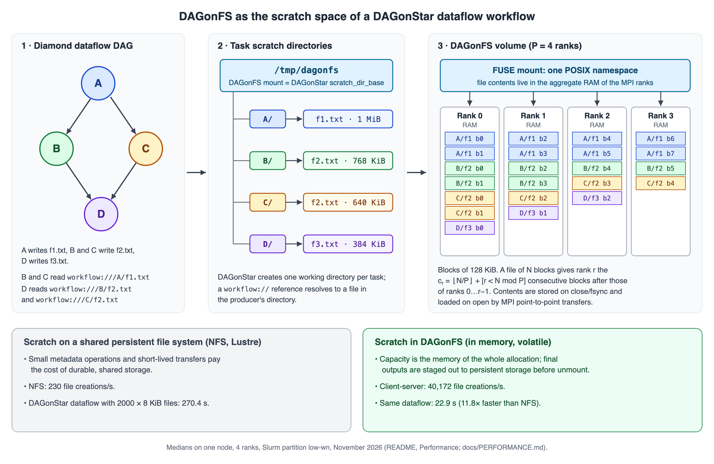
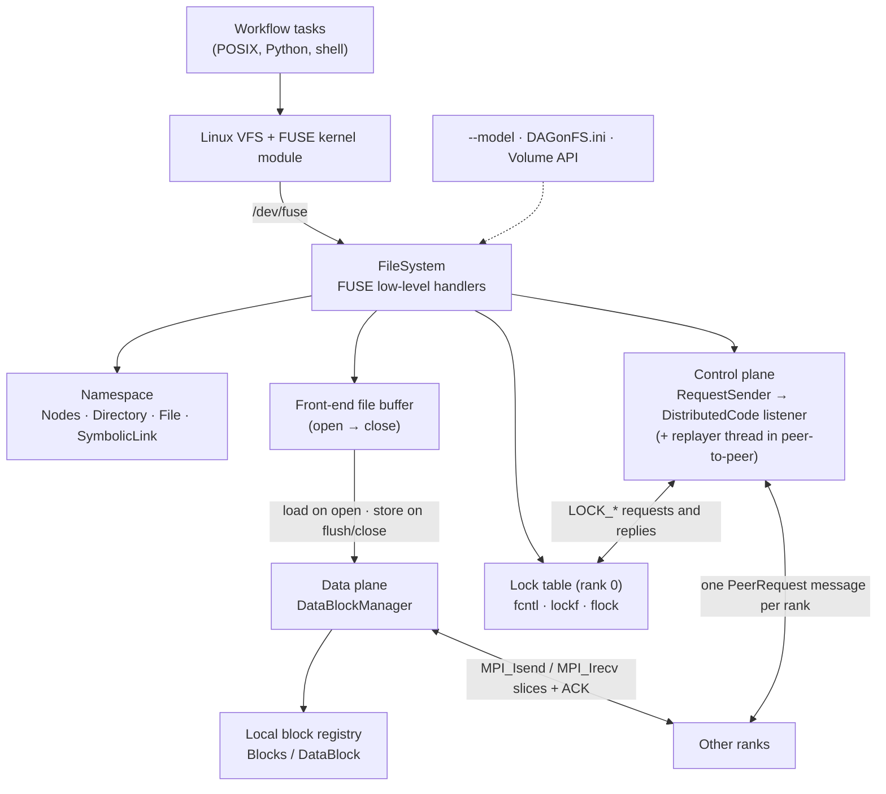
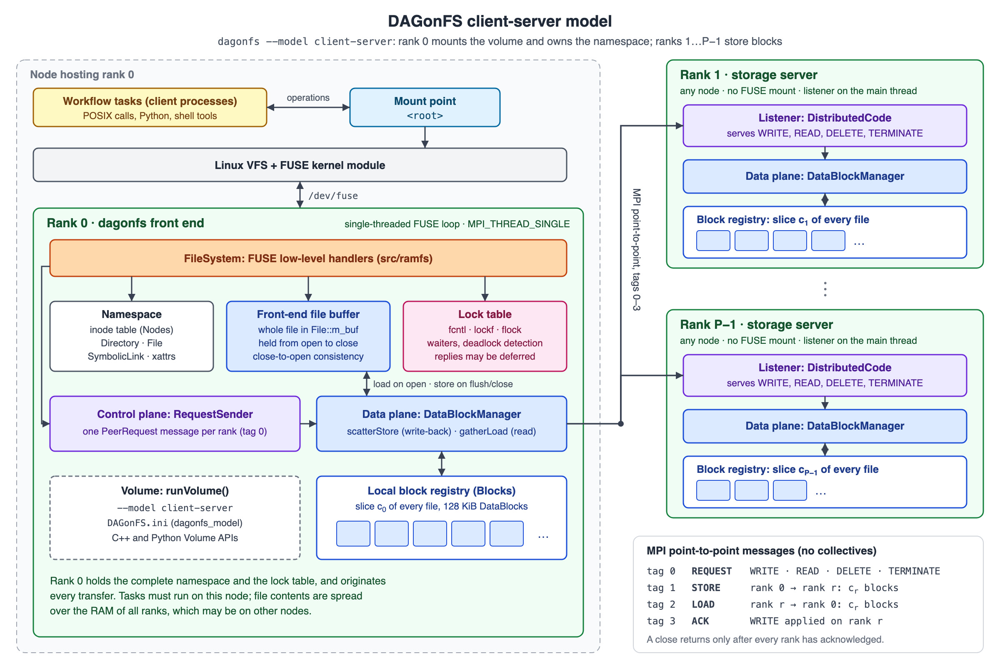
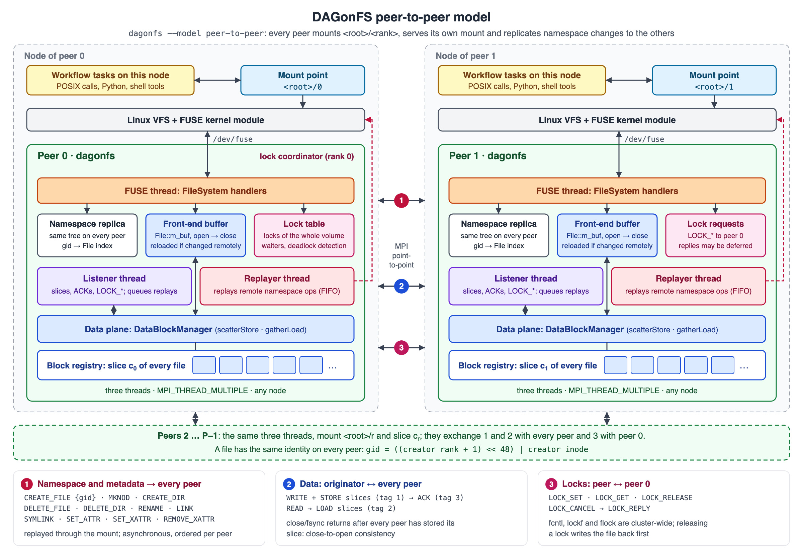
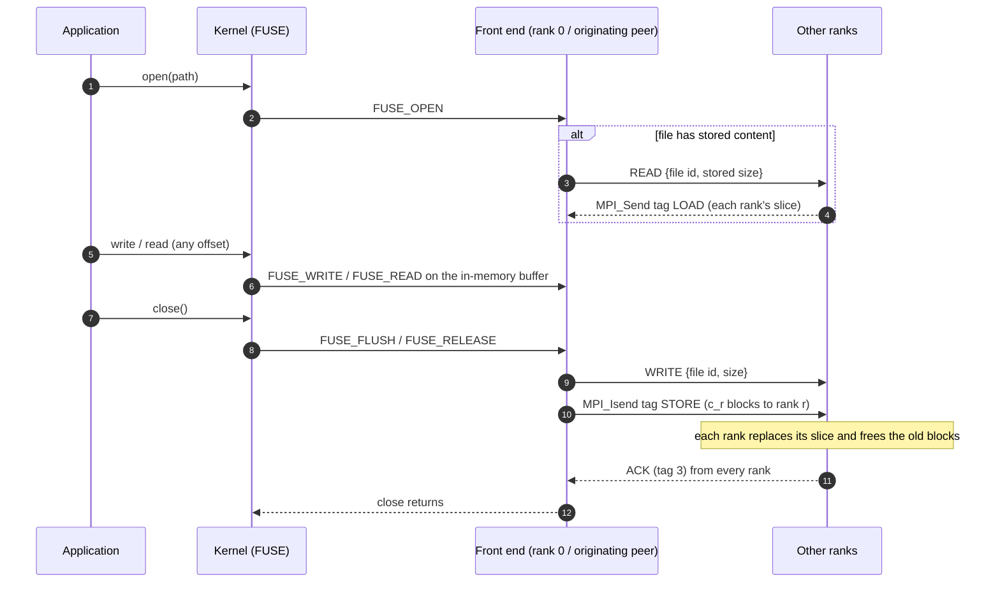
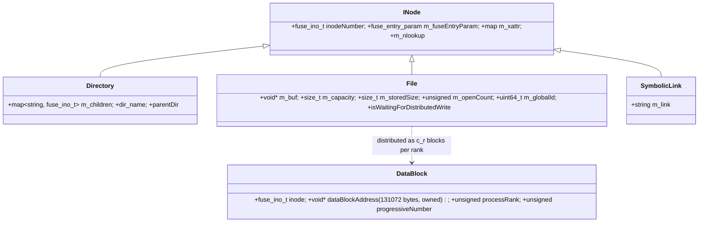

# DAGonFileSystem (DAGonFS)

[](https://github.com/DagOnStar/DAGonFS/actions/workflows/ci.yml)

DAGonFS is an **ad-hoc, in-memory, MPI-distributed file system** exposed through FUSE. It turns a directory into a POSIX namespace whose file contents are spread across the RAM of a set of MPI processes, and is designed for the *scratch data* of scientific workflows run with [DAGonStar](https://github.com/DagOnStar/dagonstar). It does not provide durable storage.

A single executable, `dagonfs`, implements two deployment models. The model is chosen per volume at run time, through `--model`, the `dagonfs_model` key of `DAGonFS.ini`, or the C++ and Python volume APIs:

| Model | Selected with | Mount points | Who serves requests |
| --- | --- | --- | --- |
| Client-server | `--model client-server` (default; alias `DAGonFS_CS.exe`) | one, on rank 0 | rank 0 holds the namespace; ranks 1…P−1 store blocks |
| Peer-to-peer | `--model peer-to-peer` (alias `DAGonFS_P2P.exe`) | one per rank, `<root>/<rank>` | every peer serves its mount and replicates namespace changes to the others |

## Contents

- [Motivation](#motivation)
- [Architecture](#architecture)
- [Data flow](#data-flow)
- [Schemas](#schemas)
- [Getting started](#getting-started)
- [Validation](#validation)
- [Performance](#performance)
- [Documentation](#documentation)
- [References and acknowledgments](#references)

## Motivation

DAGonStar's dataflow model addresses the output of a task with the `workflow://<task>/` schema, rooted at that task's scratch directory. Downstream tasks read those files, and once the workflow completes they are discarded. On HPC systems, placing this scratch space on a shared persistent file system (NFS, Lustre) makes many small metadata operations and short-lived transfers pay the cost of durable storage. DAGonFS keeps the scratch space in the aggregate memory of the allocation.



## Architecture



| Client-server | Peer-to-peer |
| --- | --- |
|  |  |

* **One implementation, one binary.** A single source tree (`src/`) builds `dagonfs`. The model is a run-time property of the volume (`dagonfs::VolumeOptions`), and the code contains no compile-time model switches.
* **Client-server.** Rank 0 mounts the file system and is the only originator. Ranks 1…P−1 run only the listener and store blocks.
* **Peer-to-peer.** Every peer runs three threads: the FUSE thread serving its mount, the **listener** serving other peers' requests and data transfers, and the **replayer** applying their namespace and metadata operations (names, symbolic links, permissions, ownership, times, extended attributes) through the local mount. All peers therefore present the same tree. Files are identified across the cluster by a global id assigned at creation.
* **Point-to-point data plane.** Transfers use non-blocking point-to-point messages and no collectives, so several peers can originate transfers concurrently. A write is acknowledged by every rank before `close` returns.
* **Complete POSIX surface.** Every FUSE operation with a POSIX counterpart is implemented, in both models: besides files, directories, links and xattrs, this includes FIFOs and sockets, `fallocate`, `SEEK_DATA`/`SEEK_HOLE`, `copy_file_range`, `poll`, and **cluster-wide advisory locks** (`fcntl`, `lockf`, `flock`) served by one lock table on rank 0, with waiting, deadlock detection and interruption. See [docs/POSIX-COMPATIBILITY.md](docs/POSIX-COMPATIBILITY.md).

Details: [docs/ARCHITECTURE.md](docs/ARCHITECTURE.md).

## Data flow

A file's content is held in a front-end buffer while it is open and distributed to all ranks when it is flushed or closed (close-to-open consistency).



The content is divided into blocks of 128 KiB and laid out **contiguously and deterministically** over the ranks, so a reader only needs the file size to locate every block. No memory address ever leaves the process that owns it.


Details: [docs/DATA-PLANE.md](docs/DATA-PLANE.md).

## Schemas

**Control messages** (both models). Each operation is one message per destination rank: a header followed by up to two paths. Client-server volumes use only `WRITE`, `READ`, `DELETE` and `TERMINATE`.

| Tag | Content |
| --- | --- |
| 0 `REQUEST` | `PeerRequest` + path bytes |
| 1 `STORE` | a rank's block slice of a `WRITE` |
| 2 `LOAD` | a rank's block slice of a `READ` |
| 3 `ACK` | the `WRITE` has been applied |

```c
typedef enum { WRITE, READ, CREATE_FILE, DELETE_FILE, CREATE_DIR,
               DELETE_DIR, RENAME, TERMINATE, LINK, DELETE } RequestType;
typedef struct { fuse_ino_t inode; size_t fileSize; size_t reqSize; off_t offset; } IORequestPacket;
typedef struct {
    RequestType     type;
    uint32_t        firstPathLength, secondPathLength;  /* bytes that follow the header */
    uint64_t        globalId;                           /* CREATE_FILE                  */
    IORequestPacket io;                                 /* WRITE / READ / DELETE        */
} PeerRequest;
```

**Per-file state** on the front end:



The complete wire specification and ordering guarantees are in [docs/PROTOCOL.md](docs/PROTOCOL.md).

## Getting started

Requirements: CMake ≥ 3.20, a C++23 compiler, MPI (Open MPI ≥ 4.1 tested; `MPI_THREAD_MULTIPLE` for peer-to-peer), libfuse ≥ 3.3 with `fusermount3` (or the FUSE 2 `fusermount`, through `tests/slurm/fuse-env.sh`). The first configure downloads log4cplus.

```bash
git clone https://github.com/DagOnStar/DAGonFS.git
cd DAGonFS
cmake -S . -B build -DUSE_MPI=ON -DCMAKE_BUILD_TYPE=Release
cmake --build build --parallel
ctest --test-dir build --output-on-failure
```

Create a volume with either model:

```bash
mpirun -np 4 build/dagonfs --model client-server -f /tmp/dagonfs   # mounted at /tmp/dagonfs
mpirun -np 4 build/dagonfs --model peer-to-peer  -f /tmp/dagonfs   # mounted at /tmp/dagonfs/0 … /3
mpirun -np 4 build/dagonfs --config DAGonFS.ini                    # model and root from the ini file
```

Or use the launcher, which reads `DAGonFS.ini` (`--model` overrides `dagonfs_model`):

```bash
cd build && cp ../src/DAGonFS.ini . && ./DAGonFS_Launcher --model peer-to-peer --dry-run
```

Or create it from Python, for example in a DAGonStar workflow script:

```python
from dagonfs import Volume            # python/dagonfs
with Volume("/tmp/dagonfs", model="peer-to-peer", ranks=4, executable="build/dagonfs") as volume:
    scratch = volume.mountpoint(0)    # /tmp/dagonfs/0; unmounted when the block ends
```

To stop the service, unmount the front end (any one peer in peer-to-peer mode); the other ranks shut down by themselves:

```bash
fusermount3 -u /tmp/dagonfs
```

See [docs/CONFIGURATION.md](docs/CONFIGURATION.md) for every option and for cluster deployment.

## Validation

| Level | Command |
| --- | --- |
| Source contract (architectural invariants, no FUSE needed) | `python3 tests/test_source_contract.py` |
| Build and smoke | `ctest --test-dir build` |
| Mounted POSIX suite (30 scenarios) + replication and cross-peer lock checks | `python3 tests/mount.py --model peer-to-peer --ranks 4 -- --oversubscribe` |
| DAGonStar workflow with Python script tasks | `python3 tests/dagonstar/run_workflow.py --model peer-to-peer --ranks 4 -- --oversubscribe` |
| Multi-node | `sbatch -N 2 --ntasks-per-node=2 tests/slurm/multinode.sbatch build` |

The November 2026 assessment found and fixed 47 defects. They include cross-address-space `free()`, double FUSE replies, peer inode desynchronisation, concurrent collectives, unreplicated metadata, inode numbers that were all 0, locks, FIFOs and space operations that were missing, and a shutdown that hung in Open MPI's HCOLL library. Before the fixes the client-server model crashed during the suite, and a peer-to-peer operation across nodes took about 400 ms. Afterwards both models pass on one node and across two Slurm nodes, including concurrent writers on two peers and parallel MPI-IO (OMPIO and ROMIO), and cross-node operations take 0.03–0.43 ms. See [docs/DEFECT-ANALYSIS.md](docs/DEFECT-ANALYSIS.md) and [docs/TESTING.md](docs/TESTING.md).

## Performance

We compared DAGonFS with the cluster's NFS home directory as the scratch space of **real DAGonStar workflows** (Slurm jobs 19513 and 19514, partition `low-wn`, 4 ranks on one node and on two nodes, November 2026). On one node DAGonFS ran a large-file dataflow (8 × 128 MiB) **1.9× faster** than NFS, the same dataflow with **Python tasks** reading and writing the volume **2.0× faster**, and a small-file dataflow (2000 files of 8 KiB staged by 8 tasks) **10.4× faster**. Spread over two nodes it stays 1.9–10.3× faster. An earlier run of the same benchmark gave 1.8–2.1× and 8.9–11.8×; differences between runs are discussed in [docs/PERFORMANCE.md](docs/PERFORMANCE.md) §4.5.


| Workload (median, one node) | NFS | DAGonFS client-server | DAGonFS peer-to-peer | tmpfs (node-local bound) |
| --- | ---: | ---: | ---: | ---: |
| File creation (ops/s) | 67 | 25,532 | 26,943 | 272,010 |
| 4 KiB files written (files/s) | 96 | 5,923 | 7,946 | 119,477 |
| 512 MiB write / read (MiB/s) | 283 / 117 | 647 / 1,186 | 841 / 1,387 | 3,371 / 5,521 |
| DAGonStar, 8 × 128 MiB, shell tasks (s) | 64.4 | 33.9 | 34.8 | 15.6 |
| DAGonStar, 8 × 128 MiB, Python tasks (s) | 62.1 | 31.3 | 39.4 | 16.2 |
| DAGonStar, 2000 × 8 KiB (s) | 257.6 | 24.7 | 28.2 | 15.0 |

Unlike tmpfs, DAGonFS presents one namespace to tasks on different nodes, and its capacity is the memory of the whole allocation. Charts for every micro-benchmark, a discussion and memory-sizing advice are in [docs/PERFORMANCE.md](docs/PERFORMANCE.md) §4. The benchmark itself is in [bench/](bench).

The WiDE '24 paper reported earlier experiments on the code base before the November 2026 assessment (file copies up to 47% faster than NFS, a DAGonStar dataflow 37% faster). They are superseded by the measurements above.

## Documentation

| Document | Content |
| --- | --- |
| [Architecture](docs/ARCHITECTURE.md) | Layers, models, request paths, consistency and failure models |
| [Data plane](docs/DATA-PLANE.md) | Block layout, point-to-point transfers, ownership invariants, cost model |
| [Protocol](docs/PROTOCOL.md) | MPI message formats and ordering |
| [POSIX compatibility](docs/POSIX-COMPATIBILITY.md) | Supported operations, cluster-wide locks, special files and semantics |
| [Configuration](docs/CONFIGURATION.md) | Build, creating volumes (CLI, ini, C++ and Python APIs), launcher, shutdown |
| [Performance](docs/PERFORMANCE.md) | Methodology, tuning, DAGonFS vs. NFS benchmark with DAGonStar |
| [DAGonStar integration](docs/DAGONSTAR-INTEGRATION.md) | Using DAGonFS as workflow scratch |
| [Testing](docs/TESTING.md) | Harness, the DAGonStar workflow test and recorded results |
| [Defect analysis](docs/DEFECT-ANALYSIS.md) | Assessment, defects and remedies |
| [Manual page](docs/man/dagonfs.1) | `dagonfs(1)` and `DAGonFS_Launcher`; read it with `man docs/man/dagonfs.1` |
| [Presentations](docs/presentations/README.md) | Scientific talk and hands-on tutorial, 20 minutes each (PowerPoint) |
| [Contributor guide](AGENTS.md) | Rules for changing the code |

## References

* C. G. De Vita, D. Caramiello, G. Mellone, D. D. Sánchez-Gallegos, V. Mele, S. Cavallo, D. Di Luccio. *An ad-hoc file system accelerated workflow application for accidental fire fast response.* In: Proceedings of the 2nd Workshop on Workflows in Distributed Environments (WiDE ’24), Athens, Greece. ACM, 2024. [doi:10.1145/3642978.3652836](https://dl.acm.org/doi/10.1145/3642978.3652836)

### Built on

* [fuse-cpp-ramfs](https://github.com/watkipet/fuse-cpp-ramfs): the in-RAM FUSE file system DAGonFS started from.
* [libfuse](https://github.com/libfuse/libfuse): the user-space FUSE interface.
* [log4cplus](https://github.com/log4cplus/log4cplus): logging.

### Acknowledgments

DAGonFileSystem is part of the research project *Directed Acyclic Graph on Cross-Application Programmable I/O* (DAGonCAPIO, https://dagoncapio.uniparthenope.it, CUP J33C22001170001). It is funded through a competitive procedure under the PNRR cascade call issued by the National Center for High-Performance Computing, Spoke 1 (PNRR M4C2 I1.4 National Champion ICSC – Cascade call SPOKE 1 – “Future HPC and Big Data”). Thematic Area 3: development and testing of methodologies, middleware and tools for distributed computing for cloud-HPC, AI-HPC and AI-cloud-HPC convergence, and their use in interdisciplinary applications.
