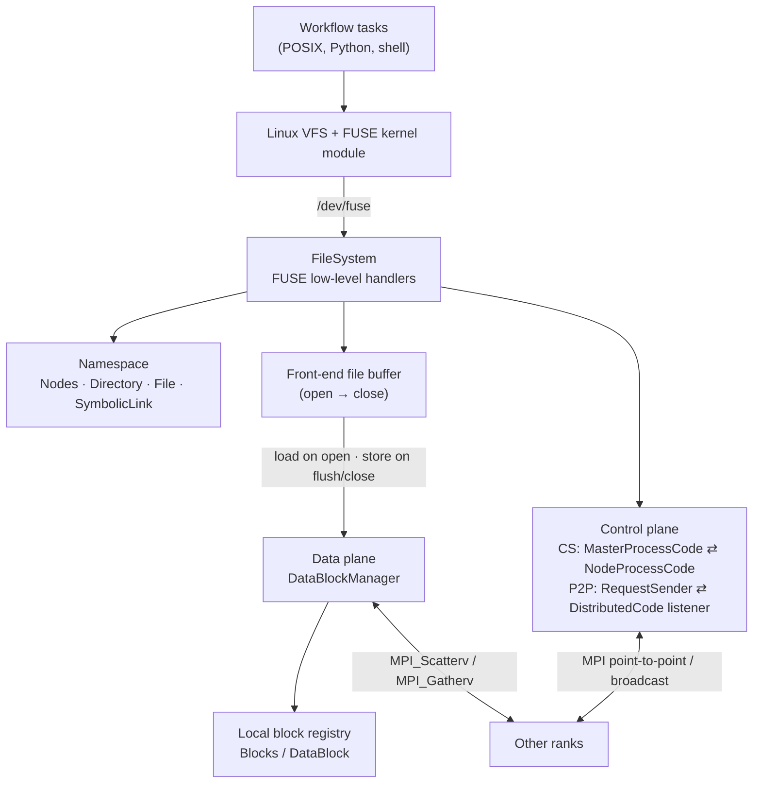
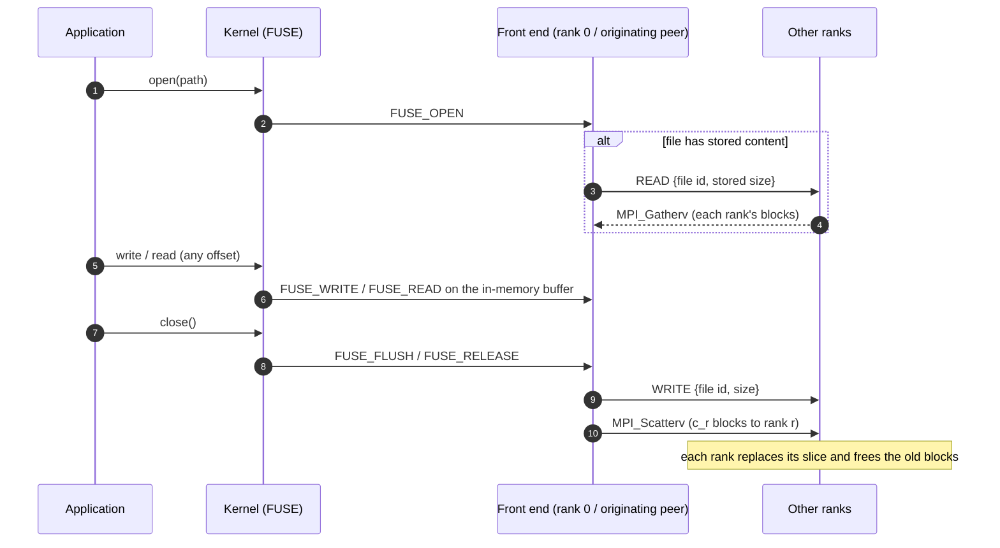
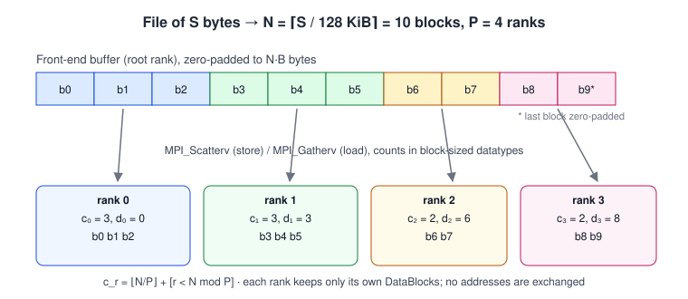
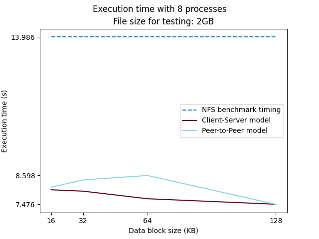
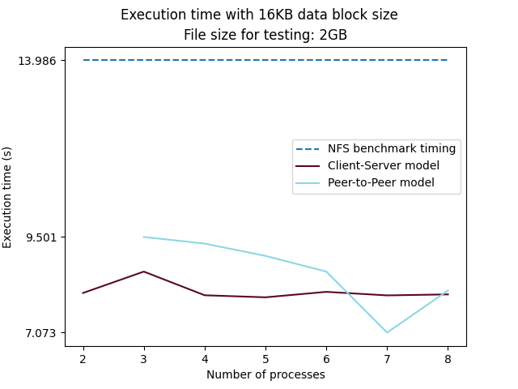
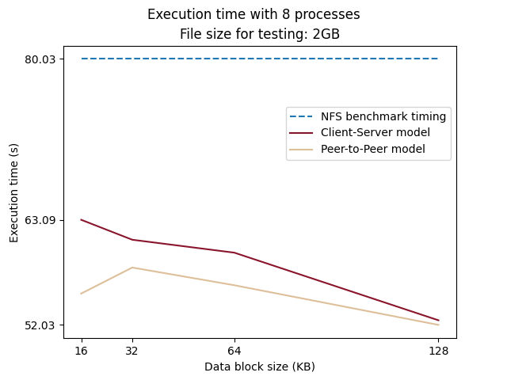
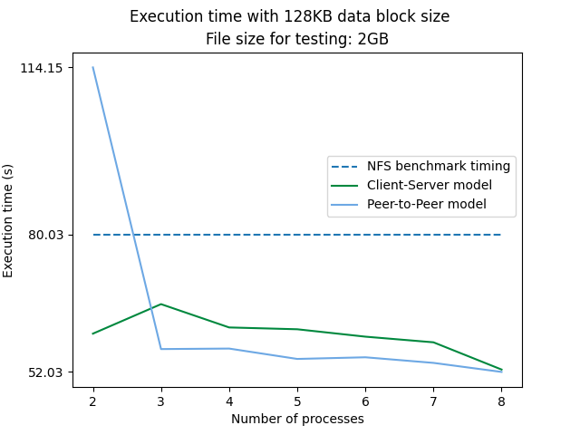

# DAGonFileSystem (DAGonFS)

[](https://github.com/DagOnStar/DAGonFS/actions/workflows/ci.yml)

DAGonFS is an **ad-hoc, in-memory, MPI-distributed file system** exposed through FUSE. It turns a directory into a POSIX namespace whose file contents are spread across the RAM of a set of MPI processes, and is designed for the *scratch data* of scientific workflows run with [DAGonStar](https://github.com/DagOnStar/dagonstar). It does not provide durable storage.

Two deployment models share a single file-system implementation:

| Model | Executable | Mount points | Who serves requests |
| --- | --- | --- | --- |
| Client-server | `DAGonFS_CS.exe` | one, on rank 0 | rank 0 holds the namespace; ranks 1…P−1 store blocks |
| Peer-to-peer | `DAGonFS_P2P.exe` | one per rank, `<root>/<rank>` | every peer serves its mount and replicates namespace changes to the others |

## Contents

- [Motivation](#motivation)
- [Architecture](#architecture)
- [Data flow](#data-flow)
- [Schemas](#schemas)
- [Getting started](#getting-started)
- [Validation](#validation)
- [Performance](#performance)
- [Documentation](#documentation)
- [References and acknowledgments](#references)

## Motivation

DAGonStar's dataflow model addresses the output of a task with the `workflow://<task>/` schema, rooted at that task's scratch directory. Downstream tasks read those files, and once the workflow completes they are discarded. On HPC systems, placing this scratch space on a shared persistent file system (NFS, Lustre) makes many small metadata operations and short-lived transfers pay the cost of durable storage. DAGonFS keeps the scratch space in the aggregate memory of the allocation.


## Architecture



| Client-server | Peer-to-peer |
| --- | --- |
|  |  |

* **One implementation, two builds.** All shared sources (`FileSystem`, the namespace classes, the data plane) are byte-identical in `src/client-server` and `src/peer-to-peer`; model-specific behaviour is selected at compile time with `DAGONFS_P2P`.
* **Client-server.** Rank 0 mounts the file system and is the only originator. Each operation is broadcast to the storage ranks, followed by the data-plane collective.
* **Peer-to-peer.** Every peer runs a FUSE thread and a listener thread. Namespace operations are replayed on every peer through its own mount, so all peers present the same tree. Files are identified across the cluster by a global id assigned at creation.

Details: [docs/ARCHITECTURE.md](docs/ARCHITECTURE.md).

## Data flow

A file's content is held in a front-end buffer while it is open and distributed to all ranks when it is flushed or closed (close-to-open consistency).



The content is divided into blocks of 128 KiB and laid out **contiguously and deterministically** over the ranks, so a reader only needs the file size to locate every block. No memory address ever leaves the process that owns it.



Details: [docs/DATA-PLANE.md](docs/DATA-PLANE.md).

## Schemas

**Client-server control messages** (broadcast from rank 0):

```c
typedef enum { WRITE, READ, CHANGE_DIR, REDUCE_BLOCKS, TERMINATE, DELETE } RequestType;
typedef struct { RequestType type; } RequestPacket;
typedef struct { fuse_ino_t inode; size_t fileSize; size_t reqSize; off_t offset; } IORequestPacket;
```

**Peer-to-peer control messages.** Each operation is one message sent to every other peer: a header followed by up to two paths.

```c
typedef enum { WRITE, READ, CREATE_FILE, DELETE_FILE, CREATE_DIR,
               DELETE_DIR, RENAME, TERMINATE, LINK } RequestType;
typedef struct {
    RequestType     type;
    uint32_t        firstPathLength, secondPathLength;  /* bytes that follow the header */
    uint64_t        globalId;                           /* CREATE_FILE                  */
    IORequestPacket io;                                 /* WRITE / READ                 */
} PeerRequest;
```

**Per-file state** on the front end:


The complete wire specification and ordering guarantees are in [docs/PROTOCOL.md](docs/PROTOCOL.md).

## Getting started

Requirements: CMake ≥ 3.20, a C++23 compiler, MPI (Open MPI ≥ 4.1 tested; `MPI_THREAD_MULTIPLE` for peer-to-peer), libfuse ≥ 3.3 with `fusermount3`. The first configure downloads log4cplus.

```bash
git clone https://github.com/DagOnStar/DAGonFS.git
cd DAGonFS
cmake -S . -B build -DUSE_MPI=ON -DCMAKE_BUILD_TYPE=Release
cmake --build build --parallel
ctest --test-dir build --output-on-failure
```

Run either model directly:

```bash
mpirun -np 4 build/DAGonFS_CS.exe  -f /tmp/dagonfs        # mounted at /tmp/dagonfs
mpirun -np 4 build/DAGonFS_P2P.exe -f /tmp/dagonfs        # mounted at /tmp/dagonfs/0 … /3
```

Or use the launcher with a configuration file:

```bash
cd build && cp ../src/DAGonFS.ini . && ./DAGonFS_Launcher --dry-run && ./DAGonFS_Launcher
```

To stop the service, unmount the front end (any one peer in peer-to-peer mode); the other ranks shut down by themselves:

```bash
fusermount3 -u /tmp/dagonfs
```

See [docs/CONFIGURATION.md](docs/CONFIGURATION.md) for every option and for cluster deployment.

## Validation

| Level | Command |
| --- | --- |
| Source contract (architectural invariants, no FUSE needed) | `python3 tests/test_source_contract.py` |
| Build and smoke | `ctest --test-dir build` |
| Mounted POSIX suite (15 scenarios) + replication checks | `python3 tests/mount.py --model peer-to-peer --ranks 4 -- --oversubscribe` |
| Multi-node | `sbatch -N 2 --ntasks-per-node=2 tests/slurm/multinode.sbatch build` |

The November 2026 assessment found and fixed 33 defects, including cross-address-space `free()`, double FUSE replies and peer inode desynchronisation. Before the fixes the client-server model crashed during the suite; afterwards both models pass on one node and across two Slurm nodes. See [docs/DEFECT-ANALYSIS.md](docs/DEFECT-ANALYSIS.md) and [docs/TESTING.md](docs/TESTING.md).

## Performance

In file-copy experiments, DAGonFS cut execution time by up to 47% compared with NFS. A DAGonStar dataflow using DAGonFS ran 37% faster than on NFS.

| File copy vs. number of processes | File copy vs. block size |
| --- | --- |
|  |  |

| DAGonStar dataflow vs. number of processes | DAGonStar dataflow vs. block size |
| --- | --- |
|  |  |

Methodology and tuning: [docs/PERFORMANCE.md](docs/PERFORMANCE.md).

## Documentation

| Document | Content |
| --- | --- |
| [Architecture](docs/ARCHITECTURE.md) | Layers, models, request paths, consistency and failure models |
| [Data plane](docs/DATA-PLANE.md) | Block layout, collectives, ownership invariants, cost model |
| [Protocol](docs/PROTOCOL.md) | MPI message formats and ordering |
| [POSIX compatibility](docs/POSIX-COMPATIBILITY.md) | Supported operations and semantics |
| [Configuration](docs/CONFIGURATION.md) | Build, command line, launcher, shutdown |
| [Performance](docs/PERFORMANCE.md) | Methodology and tuning |
| [DAGonStar integration](docs/DAGONSTAR-INTEGRATION.md) | Using DAGonFS as workflow scratch |
| [Testing](docs/TESTING.md) | Harness and recorded results |
| [Defect analysis](docs/DEFECT-ANALYSIS.md) | Assessment, defects and remedies |
| [Contributor guide](AGENTS.md) | Rules for changing the code |

## References

* C. G. De Vita, D. Caramiello, G. Mellone, D. D. Sánchez-Gallegos, V. Mele, S. Cavallo, D. Di Luccio. *An ad-hoc file system accelerated workflow application for accidental fire fast response.* In: Proceedings of the 2nd Workshop on Workflows in Distributed Environments (WiDE ’24), Athens, Greece. ACM, 2024. [doi:10.1145/3642978.3652836](https://dl.acm.org/doi/10.1145/3642978.3652836)

### Built on

* [fuse-cpp-ramfs](https://github.com/watkipet/fuse-cpp-ramfs): the in-RAM FUSE file system DAGonFS started from.
* [libfuse](https://github.com/libfuse/libfuse): the user-space FUSE interface.
* [log4cplus](https://github.com/log4cplus/log4cplus): logging.

### Acknowledgments

DAGonFileSystem is part of the research project *Directed Acyclic Graph on Cross-Application Programmable I/O* (DAGonCAPIO, https://dagoncapio.uniparthenope.it, CUP J33C22001170001). It is funded through a competitive procedure under the PNRR cascade call issued by the National Center for High-Performance Computing, Spoke 1 (PNRR M4C2 I1.4 National Champion ICSC – Cascade call SPOKE 1 – “Future HPC and Big Data”). Thematic Area 3: development and testing of methodologies, middleware and tools for distributed computing for cloud-HPC, AI-HPC and AI-cloud-HPC convergence, and their use in interdisciplinary applications.
