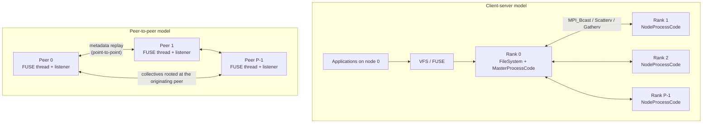
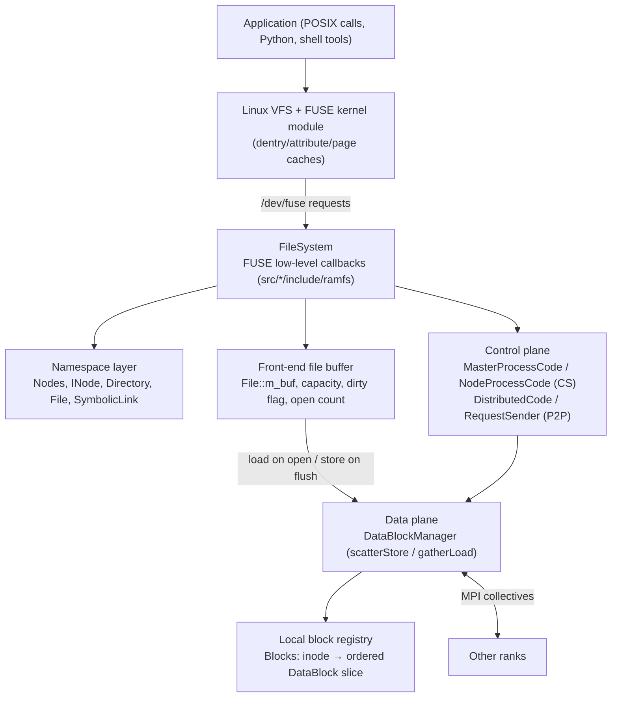
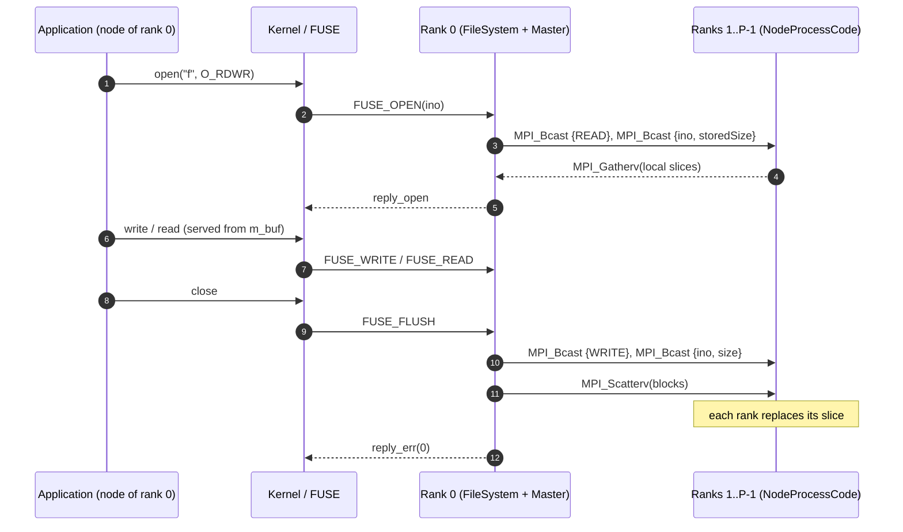
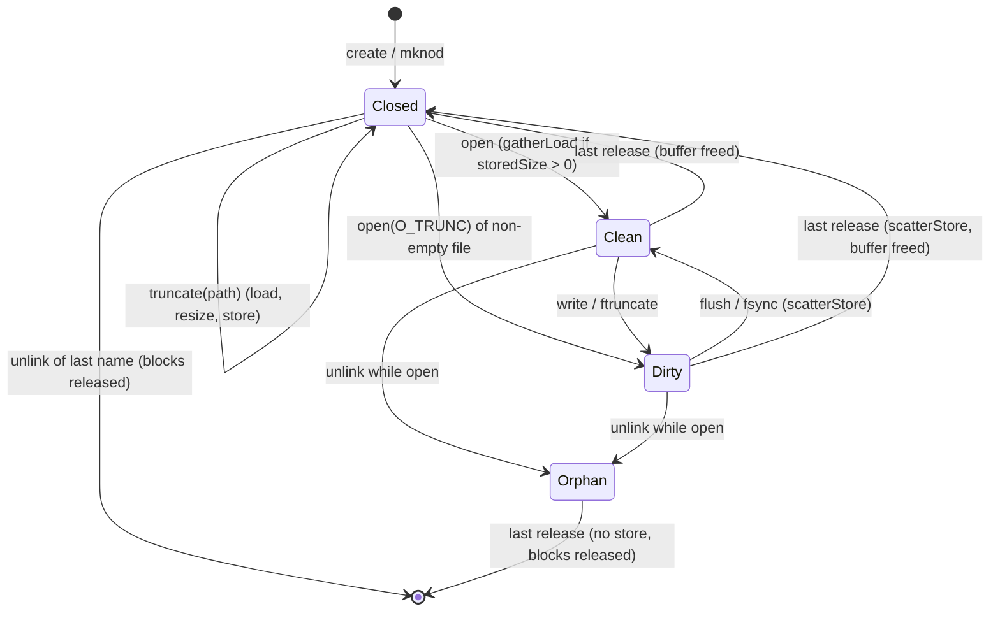
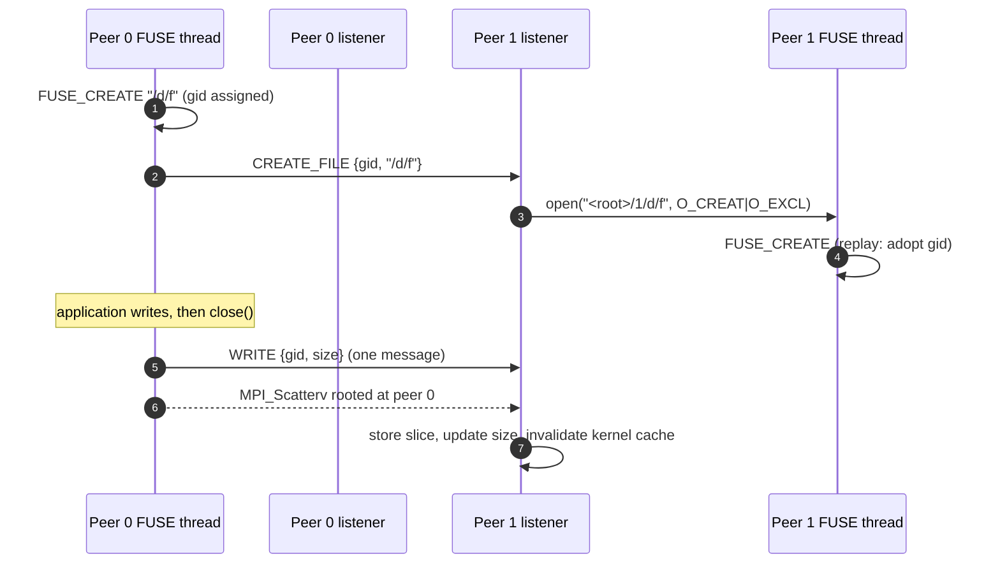

# Architecture

## 1. Purpose and design boundary

DAGonFS is an ad-hoc, in-memory file system that exposes the aggregate RAM of a set of MPI processes as a single POSIX namespace through FUSE. It was conceived for the *scratch path* of scientific workflows orchestrated by DAGonStar: the intermediate files that one task produces and a downstream task consumes, and that are discarded once the workflow completes. The design deliberately trades durability for latency and aggregate bandwidth. All metadata and contents are volatile; a successful `fsync` is an ordering barrier within the in-memory service, never a persistence guarantee.

Two deployment models are provided. They share the namespace implementation, the inode model and the data plane, and differ only in *where* requests enter the system and *how* namespace changes are propagated.

| Model | Front ends (FUSE mounts) | Namespace authority | Data plane root |
| --- | --- | --- | --- |
| Client-server (`DAGonFS_CS.exe`) | Rank 0 only | Rank 0 | Always rank 0 |
| Peer-to-peer (`DAGonFS_P2P.exe`) | Every rank, at `<root>/<rank>` | Replicated on every peer | The peer that originated the operation |

## 2. Layered decomposition

Every rank executes the same layered stack; the client-server storage ranks simply do not instantiate the FUSE layer.

**FUSE layer (`FileSystem`).** A single, shared implementation of the FUSE 3 low-level operations (`FileSystem.cpp`), compiled verbatim into both executables. Behaviour intrinsic to the distribution model is selected at compile time by the `DAGONFS_P2P` definition. Handlers validate inode numbers, parent types and names, and reply exactly once.

**Namespace layer.** An inode table (`Nodes`) holds polymorphic `INode` objects. `Directory` maps names to inode numbers through an ordered `std::map`, which gives deterministic enumeration order and stable `readdir` offsets. `File` carries the per-file I/O state described in §4. Inode 0 is a placeholder so that the root directory receives `FUSE_ROOT_ID` (1).

**Data plane (`DataBlockManager`, `Blocks`, `DataBlock`).** File contents are partitioned into fixed blocks of $B = 128\ \text{KiB}$ and distributed over all ranks with a deterministic, contiguous layout (see [DATA-PLANE.md](DATA-PLANE.md)). Each rank keeps only the blocks it owns; no process-local address ever crosses an MPI boundary.

**Control plane.** In the client-server model, rank 0 broadcasts a request header to the storage ranks, which loop in `NodeProcessCode::start`. In the peer-to-peer model, each peer runs a listener thread (`DistributedCode::start`) that serves requests originating at other peers, while the peer's FUSE thread originates its own. The message formats are specified in [PROTOCOL.md](PROTOCOL.md).

## 3. Client-server model

Rank 0 mounts the file system and owns the complete namespace. Ranks $1 \ldots P-1$ are pure storage servers. Because only rank 0 receives kernel requests, the namespace is never replicated and every data-plane collective is rooted at rank 0. Applications must therefore run on the node hosting rank 0, while the aggregate memory of all ranks — possibly on other nodes — stores file contents.

## 4. File I/O state machine

A file's content lives in two places: the *distributed copy* (blocks spread over the ranks, of `m_storedSize` bytes) and, while at least one descriptor is open, the *front-end buffer* `m_buf` on the front-end rank. The buffer is a whole-file, block-aligned, zero-padded image; reads and writes are served from it at memory speed, and the distributed copy is refreshed at well-defined synchronisation points.

The state is carried by four fields of `File`: `m_buf`/`m_capacity` (the buffer and its block-aligned size), `m_storedSize` (size of the distributed copy, which fixes the block layout for the next read), `m_openCount` (open handles; the buffer is shared by all descriptors of the inode), and the dirty flag. The logical size `st_size` may differ from `m_storedSize` between synchronisation points, e.g. after `ftruncate` grows a file; bytes beyond `m_storedSize` are materialised as zeros.

## 5. Peer-to-peer model

Each peer mounts `<root>/<rank>` and holds a full replica of the namespace. A namespace mutation performed on peer $i$ (create, mknod, mkdir, unlink, rmdir, rename, link) is applied locally, acknowledged to the kernel, and then sent to every other peer, whose listener thread *replays* it by issuing the corresponding system call on its own mount point. A thread-safe "replayed" flag, consumed at the top of the FUSE handler, prevents the replay from being re-broadcast.

File data are addressed by a **cluster-wide identity** assigned at creation, $\mathit{gid} = ((r_c + 1) \ll 48) \,|\, \mathit{ino}_c$, where $r_c$ and $\mathit{ino}_c$ are the creating peer and its local inode number. The identity travels in the create message, so every peer indexes the same file under the same key even though local inode numbers diverge (for example because symbolic links are not replicated). When a remote write changes a file, the listener updates the local replica's size and invalidates the local kernel's cached attributes and pages (`fuse_lowlevel_notify_inval_inode`), so a subsequent read observes the new contents.

## 6. Consistency model

* **Client-server.** Rank 0 serialises all requests (the FUSE loop is single-threaded), so the file system is linearizable from the point of view of applications on node 0. Within a node, the kernel's attribute and entry caches (1 s timeouts) are kept coherent because every mutation flows through the same process.
* **Peer-to-peer.** Namespace replication is asynchronous and ordered per originating peer (MPI's non-overtaking rule on a single communicator and tag). Data visibility follows *close-to-open* semantics: a writer's content becomes visible to other peers when it closes (or `fsync`s) the file, and a reader that opens the file afterwards obtains it. Concurrent mutations of the same object from different peers are not arbitrated.

## 7. Failure model and limitations

DAGonFS keeps no replica, log or checkpoint: a rank failure loses the blocks it stores and, in the client-server model, the loss of rank 0 loses the namespace. MPI's default error handler aborts the job. The following limitations are inherent to the current design and are documented rather than hidden:

1. **Whole-file front-end buffering.** A file opened on a front end must fit in that process's memory; the distributed copy multiplies capacity but not the size of a single open file.
2. **Concurrent originators in peer-to-peer mode.** Two peers that originate data-plane collectives at the same time on `MPI_COMM_WORLD` violate MPI's ordering requirements for collectives and can deadlock. Workflows should ensure that at any instant at most one peer is writing or opening a file, which is the natural regime of DAG-structured tasks synchronised by the engine.
3. **Metadata not replicated in peer-to-peer mode.** `chmod`, `chown`, `utimens`, extended attributes and symbolic links are local to the peer that performed them.
4. **No byte-range locks.** `getlk` reports `F_UNLCK`; `setlk`/`flock` are not registered.

## 8. Source map

| Component | Client-server | Peer-to-peer |
| --- | --- | --- |
| Entry point | `src/client-server/main.cpp` | `src/peer-to-peer/main.cpp` |
| FUSE callbacks (shared) | `include/ramfs/FileSystem.{hpp,cpp}` | identical copy |
| Namespace (shared) | `include/nodes/*` | identical copy |
| Data plane (shared) | `include/mpi/DataBlockManager.*`, `include/blocks/*` | identical copy |
| Control plane | `include/mpi/MasterProcessCode.*`, `NodeProcessCode.*` | `include/mpi/DistributedCode.*`, `RequestSender.*` |
| Wire formats | `include/mpi/mpi_data.hpp` | `include/mpi/mpi_data.hpp` |
| Launcher | `src/DAGonFS_Launcher.cpp` | same |

`tests/test_source_contract.py` fails if any shared file diverges between the two trees.
