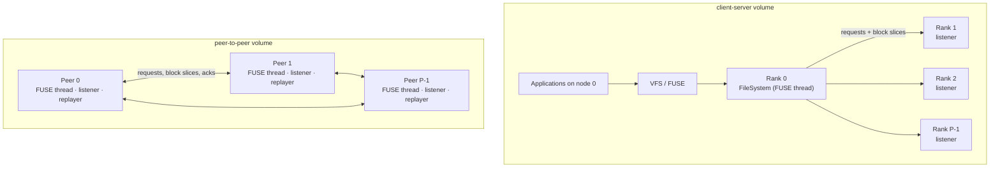
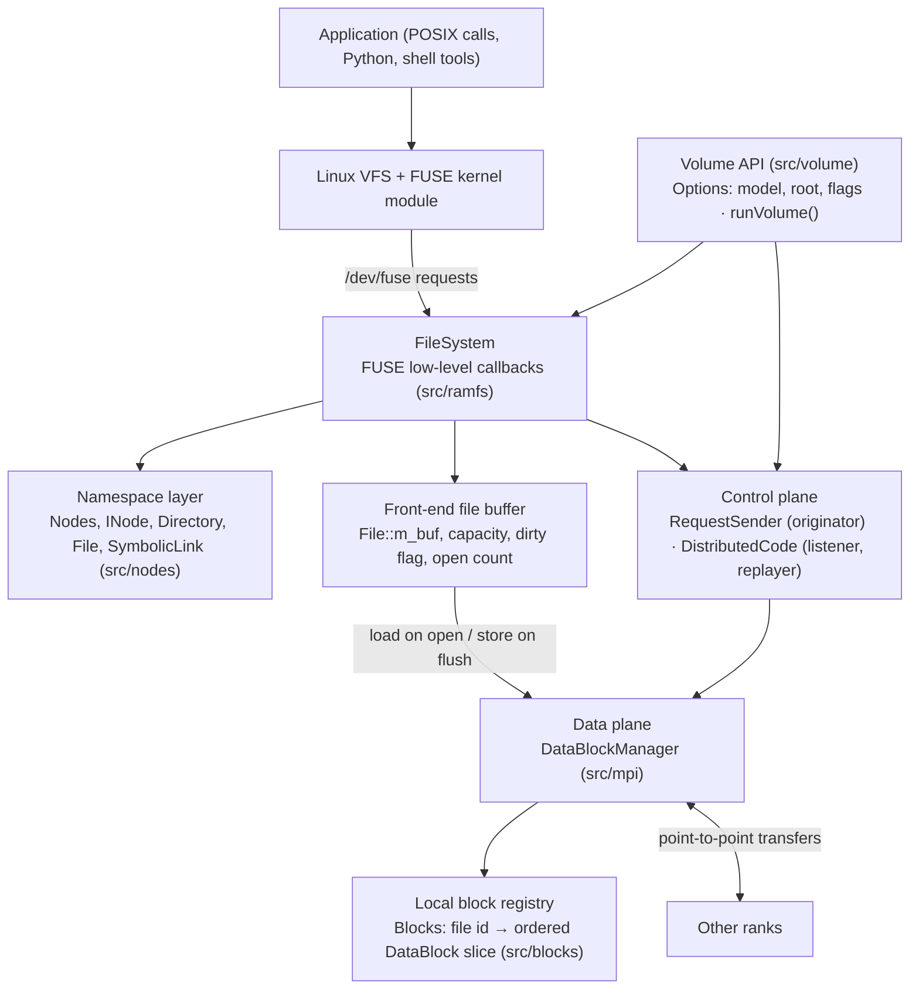
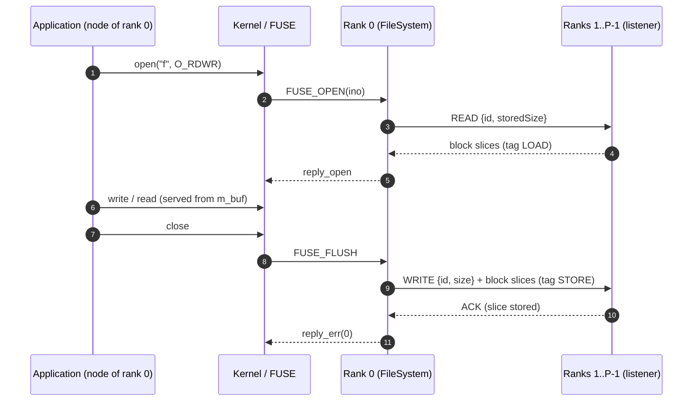
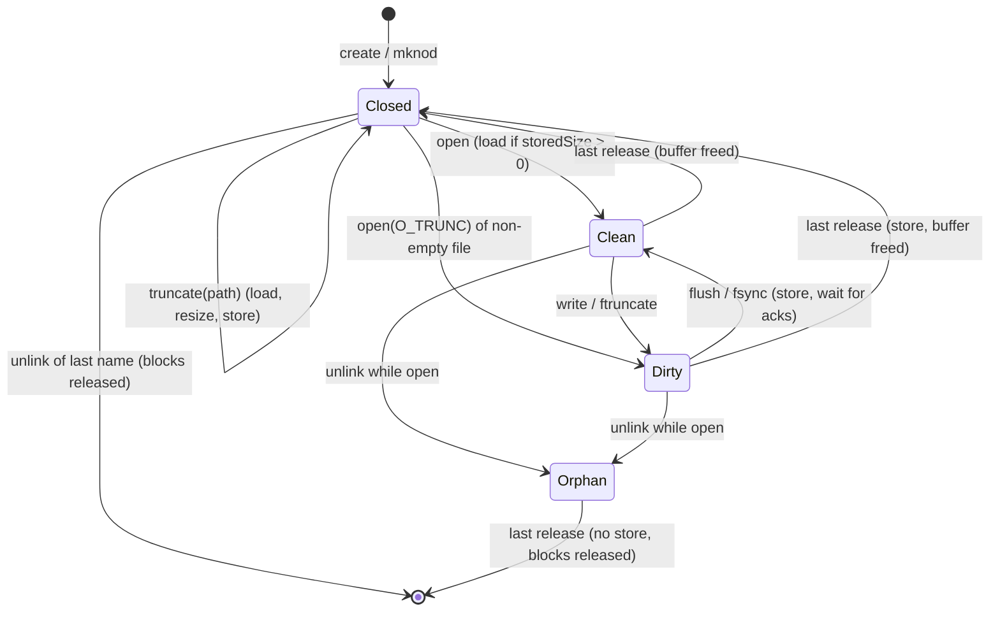
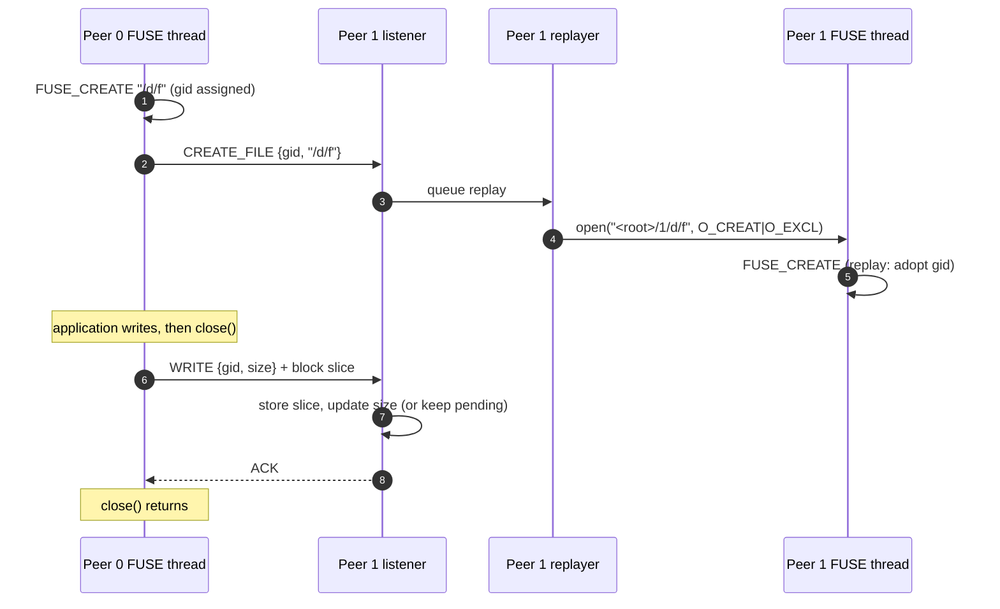

# Architecture

## 1. Purpose and design boundary

DAGonFS is an ad-hoc, in-memory file system. It exposes the aggregate RAM of a set of MPI processes as a single POSIX namespace through FUSE. It was conceived for the *scratch path* of scientific workflows orchestrated by DAGonStar: the intermediate files that one task produces and a downstream task consumes, and that are discarded once the workflow completes. The design deliberately trades durability for latency and aggregate bandwidth. All metadata and contents are volatile. A successful `fsync` is an ordering barrier within the in-memory service, never a persistence guarantee.

A DAGonFS **volume** is created by running the single executable `dagonfs` on every rank of an MPI job. The volume's *deployment model* is a run-time property of the volume, not of the build. It is chosen with `dagonfs --model`, with the `dagonfs_model` key of `DAGonFS.ini`, or with `dagonfs::VolumeOptions` in the C++ and Python APIs:

| Model | Front ends (FUSE mounts) | Namespace authority | Originator of data transfers |
| --- | --- | --- | --- |
| `client-server` | Rank 0 only, at `<root>` | Rank 0 | Always rank 0 |
| `peer-to-peer` | Every rank, at `<root>/<rank>` | Replicated on every peer | The peer on which the application performed the operation |

The two models share all code. They differ only in which ranks mount the volume, and in whether namespace operations are replicated to the other ranks.

## 2. Layered decomposition

Every rank executes the same stack. In a client-server volume, ranks other than 0 do not instantiate the FUSE layer.

**Volume layer (`src/volume`).** `Options` parses the model, mount root and flags from the command line and from `DAGonFS.ini`, with no MPI or FUSE dependency, so the launcher shares it. `runVolume()` starts the rank's role for the chosen model; it is the entry point of both `dagonfs` and the C++ API.

**FUSE layer (`FileSystem`).** One implementation of the FUSE 3 low-level operations. Behaviour that depends on the model is selected at run time by `FileSystem::peerToPeer`: namespace replication, inode reclamation and kernel cache timeouts. Handlers validate inode numbers, parent types and names, and reply exactly once.

**Namespace layer.** An inode table (`Nodes`) holds polymorphic `INode` objects. `Directory` maps names to inode numbers through an ordered `std::map`, which gives a deterministic enumeration order and stable `readdir` offsets. `File` carries the per-file I/O state described in §4. Inode 0 is a placeholder, so the root directory receives `FUSE_ROOT_ID` (1).

**Data plane (`DataBlockManager`, `Blocks`, `DataBlock`).** File contents are divided into fixed blocks of $B = 128\ \text{KiB}$ and distributed over all ranks with a deterministic, contiguous layout (see [DATA-PLANE.md](DATA-PLANE.md)). Each rank keeps only the blocks it owns. No process-local address ever crosses an MPI boundary.

**Control plane (`RequestSender`, `DistributedCode`).** The rank where an operation originates sends one self-describing request message to each other rank. Every rank that is not a pure originator runs a *listener* (`DistributedCode::start`). The listener serves data transfers, block releases and acknowledgements, and hands namespace replays to a separate *replayer* thread. The message formats are specified in [PROTOCOL.md](PROTOCOL.md).

### Threads per rank

| Rank role | FUSE thread | Listener | Replayer |
| --- | --- | --- | --- |
| client-server rank 0 | yes (single-threaded FUSE loop) | — | — |
| client-server rank r ≥ 1 | — | main thread | — |
| peer-to-peer peer | yes | yes | yes |

Peer-to-peer ranks need `MPI_THREAD_MULTIPLE`; client-server ranks need only `MPI_THREAD_SINGLE`. `dagonfs` parses the model before `MPI_Init_thread`, so each volume requests exactly the level it needs.

## 3. Client-server model

Rank 0 mounts the volume and owns the complete namespace. Ranks $1 \ldots P-1$ are storage servers. Only rank 0 receives kernel requests, so the namespace is never replicated and every data transfer is rooted at rank 0. Applications must therefore run on the node hosting rank 0. The aggregate memory of all ranks, possibly on other nodes, stores the file contents.

## 4. File I/O state machine

A file's content lives in two places. The *distributed copy* is spread in blocks over the ranks and holds `m_storedSize` bytes. While at least one descriptor is open, the *front-end buffer* `m_buf` on the front-end rank holds a whole-file, block-aligned, zero-padded image. Reads and writes are served from the buffer at memory speed, and the distributed copy is refreshed at well-defined synchronisation points.

The state is carried by four fields of `File`:

* `m_buf`/`m_capacity`: the buffer and its block-aligned size.
* `m_storedSize`: the size of the distributed copy, which fixes the block layout for the next read.
* `m_openCount`: the number of open handles. All descriptors of the inode share one buffer.
* The dirty flag.

The logical size `st_size` may differ from `m_storedSize` between synchronisation points, for example after `ftruncate` grows a file. Bytes beyond `m_storedSize` are materialised as zeros. Reads never extend past `m_capacity`, whatever the size says.

## 5. Peer-to-peer model

Each peer mounts `<root>/<rank>` and holds a full replica of the namespace. A namespace mutation performed on peer $i$ (create, mknod, mkdir, unlink, rmdir, rename, link) follows four steps:

1. It is applied locally.
2. It is acknowledged to the kernel.
3. It is sent to every other peer.
4. On each receiving peer, the listener queues it for that peer's *replayer*, which issues the corresponding system call on the peer's own mount point.

A replayed request is recognised by the requesting thread: the FUSE context reports the replayer's kernel thread id. A replay is therefore never re-broadcast, even when a local request for the same directory was queued in the kernel just before it.

File data are addressed by a **cluster-wide identity** assigned at creation, $\mathit{gid} = ((r_c + 1) \ll 48) \,|\, \mathit{ino}_c$, where $r_c$ and $\mathit{ino}_c$ are the creating peer and its local inode number. The identity travels in the create message, so every peer indexes the same file under the same key, even though local inode numbers diverge (for example because symbolic links are not replicated).

When a remote write changes a file, the listener updates the local replica's size. If the replayed create has not run yet, the size is kept as *pending* and applied when the create assigns the identity. The listener then invalidates the local kernel's cached pages, and only then acknowledges the write.

### 5.1 Why three threads

A replayed system call is served by the peer's own FUSE thread. That thread may itself be blocked, waiting for an acknowledgement or a block slice from another peer's listener. If the listener performed replays itself, two peers writing at the same time could each wait for the other's listener, while each listener waits for its own FUSE thread, and the volume would deadlock. Replays therefore run on the replayer. The listener only performs work that completes without the local kernel, so every wait-for chain ends at a listener that can make progress.

## 6. Consistency model

* **Client-server.** Rank 0 serialises all requests (the FUSE loop is single-threaded), so the file system is linearizable from the point of view of applications on node 0. The kernel's attribute and entry caches (1 s timeouts) stay coherent because every mutation flows through the same process.
* **Peer-to-peer.**
  * *Namespace and metadata replication* is asynchronous and ordered per originating peer, by MPI's non-overtaking rule on a single communicator and tag. Names, symbolic links, permissions, ownership, timestamps and extended attributes changed on one peer appear on the others shortly afterwards.
  * *Data* follows **close-to-open** semantics. A writer's `close` (or `fsync`) returns only after every peer has stored its slice and updated its view of the file, so any `open` that starts afterwards on any peer where the name is visible observes the new content.
  * The kernel does not cache names or attributes (timeouts 0), because the listener changes them asynchronously. Concurrent mutations of the same object from different peers are not arbitrated: the last write-back wins.

## 7. Failure model and limitations

DAGonFS keeps no replica, log or checkpoint. A rank failure loses the blocks that rank stores, and in the client-server model the loss of rank 0 also loses the namespace. MPI's default error handler aborts the job. The following limitations are inherent to the current design and are documented rather than hidden:

1. **Whole-file front-end buffering.** A file opened on a front end must fit in that process's memory. The distributed copy multiplies total capacity, but not the size of a single open file.
2. **No byte-range locks.** `getlk` reports `F_UNLCK`; `setlk`/`flock` are not registered.
3. **No arbitration of concurrent writers.** Two peers that write the same file at the same time are not serialised: the last write-back wins (§6).
4. **Homogeneous ranks.** Messages are raw structures, so all ranks must run the same binary on the same architecture.

## 8. Source map

| Component | Location |
| --- | --- |
| Entry point (`dagonfs`) | `src/main.cpp` |
| Volume API: options, ini, command line, `runVolume` | `src/volume/Options.*`, `src/volume/Volume.*` |
| FUSE callbacks | `src/ramfs/FileSystem.*` |
| Namespace | `src/nodes/*` |
| Data plane | `src/mpi/DataBlockManager.*`, `src/blocks/*` |
| Control plane | `src/mpi/RequestSender.*` (originator), `src/mpi/DistributedCode.*` (listener, replayer) |
| Wire format | `src/mpi/mpi_data.hpp` |
| Launcher | `src/DAGonFS_Launcher.cpp` |
| Python API | `python/dagonfs/` |

`tests/test_source_contract.py` checks mechanically that there is no model-specific source tree and no compile-time model switch.
