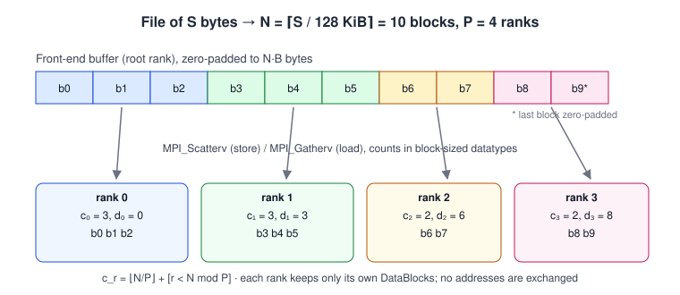

# Data plane

This document specifies how DAGonFS places file contents in the memory of the MPI ranks and how the content is moved between the front-end buffer and the distributed copy. The data plane (`DataBlockManager`, `Blocks`, `DataBlock`) is shared verbatim by both deployment models.

## 1. Block decomposition

Let $S$ be the size in bytes of the content to store and $B$ the block size (`FILE_SYSTEM_SINGLE_BLOCK_SIZE`, $B = 131072$). The content is padded with zeros to

$$N = \left\lceil S / B \right\rceil$$

whole blocks. Padding keeps every transfer a multiple of a block-sized MPI datatype and makes the stored image deterministic.

## 2. Contiguous block layout

Given $P$ ranks, rank $r \in \{0,\ldots,P-1\}$ owns

$$c_r = \left\lfloor N / P \right\rfloor + [\, r < N \bmod P \,]$$

consecutive blocks starting at index

$$d_r = \sum_{q<r} c_q .$$

The layout is a pure function of $(N, P)$. This property is central to the design: a read only needs the *stored size* $S$ of the file — a value type carried in a 32-byte request header — to reconstruct where every block lives. Consequently, no rank ever needs to know an address in another process's memory.

The layout balances memory within one block per rank ($\max_r c_r - \min_r c_r \le 1$) and gives rank 0 at least as many blocks as any other rank. An immediate corollary used by the implementation is that if rank 0 stores no block of a file, no rank does.

## 3. Collective operations

Both operations are collectives over `MPI_COMM_WORLD` with a designated root: rank 0 in the client-server model, the originating peer in the peer-to-peer model. Counts and displacements are expressed in units of a committed contiguous datatype of $B$ bytes, so a file of up to $2^{31}-1$ blocks (256 TiB) can be described without overflowing MPI's `int` counts.

### 3.1 `scatterStore` (write-back)

1. The root holds the front-end buffer, of at least $N \cdot B$ bytes, with the padding zeroed.
2. Every rank allocates $c_r$ fresh `DataBlock`s.
3. The rank describes its new blocks with an `MPI_Type_create_hindexed` datatype built from their absolute addresses, and receives its slice of `MPI_Scatterv` directly into them (`MPI_BOTTOM`). No intermediate staging buffer and no `memcpy` are needed.
4. The rank atomically replaces its previous slice of the file in the `Blocks` registry and frees the old blocks.

A size of zero releases the slices on every rank. Because each write replaces the whole slice, the number of blocks held for a file always equals its current layout, and rewriting a file never leaks memory.

### 3.2 `gatherLoad` (read)

1. Every rank looks up its slice for the file; if the slice is shorter than $c_r$ (which can only happen after an inconsistent history), it is padded with zero blocks so the collective can always complete.
2. The slice is described with an `hindexed` datatype and sent with `MPI_Gatherv` from `MPI_BOTTOM`.
3. The root receives the $N$ blocks contiguously into a newly allocated buffer, which becomes the file's front-end buffer.

### 3.3 Release

When the last name of a file disappears and no descriptor is open, its blocks are released. In the client-server model rank 0 broadcasts a `DELETE` request; in the peer-to-peer model every peer replays the `unlink` and releases its own slice locally, so no collective is required.

## 4. Ownership and safety invariants

* **I1 — Ownership.** A `DataBlock` allocates its buffer in its constructor and frees it in its destructor; it is non-copyable and never adopts a foreign address.
* **I2 — Locality.** The registry of a rank contains only blocks allocated by that rank.
* **I3 — Value-only messages.** MPI packets contain integers and length-bounded byte strings. Process-local pointers are never transmitted (enforced by `tests/test_source_contract.py`).
* **I4 — Layout determinism.** The block layout used by a read is computed from the stored size recorded by the preceding write, so writer and readers agree on block ownership without exchanging metadata.
* **I5 — Thread safety.** All registry operations take an internal mutex, because in the peer-to-peer model the FUSE thread and the listener thread of a peer access the registry concurrently.

The original implementation violated I1–I3: ranks exchanged raw block addresses, the front end stored addresses belonging to other processes, and overwriting a block freed the previous address — which, for a block owned by another rank, is an invalid `free()` in the wrong address space. See [DEFECT-ANALYSIS.md](DEFECT-ANALYSIS.md) for the full account.

## 5. Cost model

For a store of $S$ bytes over $P$ ranks with a linear-cost network model (latency $\alpha$, inverse bandwidth $\beta$),

$$T_{store}(S) \approx T_{bcast}(\text{header}) + T_{scatter}(S) \approx 2\alpha\lceil\log_2 P\rceil + \alpha (P-1) + \beta\,\frac{P-1}{P}\,N B,$$

assuming a linear scatter (the common implementation for `MPI_Scatterv`). A load has the symmetric cost with `MPI_Gatherv`. The front-end rank keeps $1/P$ of the data locally, so only the fraction $(P-1)/P$ crosses the network. The per-operation constant terms dominate for small files, which is why DAGonFS synchronises at `close`/`fsync` rather than on every `write`.
