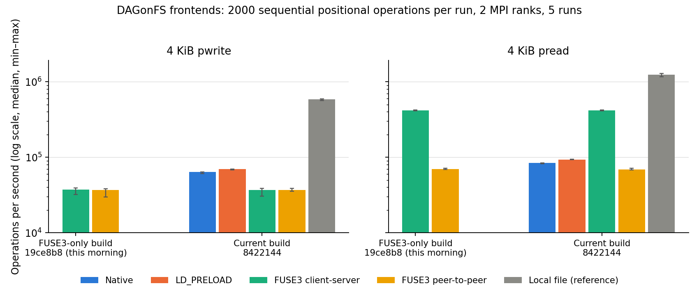
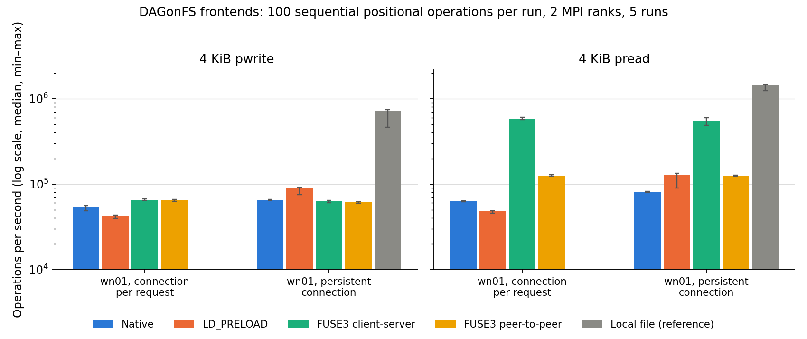
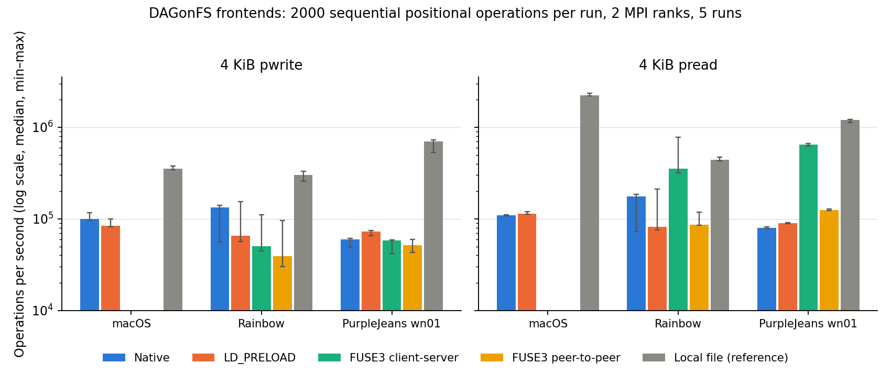

# Frontend performance report

This report compares the FUSE3, native and LD_PRELOAD frontends with a
positional-I/O microbenchmark, and measures the effect of the native protocol
version 2 (one persistent connection per client process instead of one
connection per request; see [FRONTENDS.md](FRONTENDS.md)).

## Method

`bench/frontend_probe.py` starts a fresh two-rank client-server volume for each
run, writes OPS successive 4 KiB blocks with `pwrite`, reads them back with
`pread`, closes the file and shuts the volume down; a run counts only if every
rank exits with status 0. Five runs per mode; the tables give medians, the
figures add the minimum and maximum.

| Mode | Client | Path through the system |
|---|---|---|
| native | Python, `ctypes` calls into the C client | Unix socket to rank 0 |
| preload | C program under `LD_PRELOAD` / `DYLD_INSERT_LIBRARIES` | Unix socket to rank 0 |
| fuse | Python `os.pwrite`/`os.pread` | kernel FUSE to rank 0, client-server |
| fuse-p2p | Python `os.pwrite`/`os.pread` | kernel FUSE to rank 0, peer-to-peer |
| local | Python `os.pwrite`/`os.pread` | local file system (reference) |

The native and preload probes use different callers (Python and C), so their
absolute rates are not directly comparable: the C caller exposes more of the
protocol cost. These are warm-cache, single-client latency tests, not
durability, bandwidth or multi-client measurements.

```sh
python3 bench/frontend_probe.py --modes native,preload,fuse,fuse-p2p,local \
    --repeats 5 --ops 2000 --output bench/results/frontends-HOST.json -- --oversubscribe
sbatch -p low-wn bench/slurm/frontend_probe.sbatch 2000   # one Slurm node; FUSE modes skipped without /dev/fuse
python3 bench/plot_frontends.py figures/OUT.png RESULT.json=LABEL ...
```

| Host | CPU | OS, MPI | Notes |
|---|---|---|---|
| macOS | Apple M4 Max | macOS 26, Open MPI 5.0 | no `/dev/fuse`: native, preload and local only |
| Rainbow | AMD Ryzen 9 9900X, 12 cores | Ubuntu, kernel 6.17, GCC 13, Open MPI 4.1.6, libfuse 3.14 | shared workstation, load average ≈ 12 during the runs |
| PurpleJeans `low-wn` | 2 × Intel Xeon Gold 5218, 32 cores | Rocky Linux 8.10, GCC 12.2.1, Open MPI 4.1.4 | wn01: jobs 19750 (before), 19770 and 19771 (after); wn04: job 19788 (versus FUSE3-only) |

Sunbow (`193.205.230.23`) was reachable but has no MPI or CMake in its default
environment, so it has no results.

## Versus the FUSE3-only implementation

The same probe compares the current build (`8422144`) with the FUSE3-only
build of this morning (`19ce8b8`, before the native and preload frontends were
added). Both were built from clean trees with the same compiler, flags,
libfuse and MPI, and run in one exclusive Slurm job on wn04 (job 19788): after
a warm-up, each of five rounds runs every mode of both builds once, so the
builds see the same node state. Medians in thousands of operations per second,
with the ratio to this morning's FUSE3 client-server volume:

| Build, mode | `pwrite` | vs. morning | `pread` | vs. morning |
|---|---:|---:|---:|---:|
| this morning, FUSE3 client-server | 37.5 | 1.00 | 416.8 | 1.00 |
| this morning, FUSE3 peer-to-peer | 37.1 | 0.99 | 70.1 | 0.17 |
| current, FUSE3 client-server | 36.9 | 0.98 | 416.0 | 1.00 |
| current, FUSE3 peer-to-peer | 36.9 | 0.98 | 68.8 | 0.17 |
| current, native | 63.6 | **1.69** | 83.7 | 0.20 |
| current, preload | 69.6 | **1.85** | 93.5 | 0.22 |
| local file (reference) | 586.0 | 15.6 | 1,241.5 | 3.0 |



- **FUSE3 is unchanged.** Both models perform the same in both builds (within
  2%, well inside the run-to-run spread): adding the frontends cost the FUSE
  path nothing, as expected, since its code did not change on Linux.
- **The socket frontends write 1.7–1.9× faster than FUSE3** on this node: one
  socket round trip replaces a trip through the kernel's FUSE queue.
- **FUSE3 client-server still reads 4.5–5× faster** thanks to the kernel page
  cache; the socket frontends read 1.2–1.3× faster than FUSE3 peer-to-peer,
  which runs without that cache.

An earlier, non-interleaved job (19783, wn02) showed the current FUSE3 build
1.6× faster than the morning build. That job ran each build's modes in
separate blocks, and the current build's FUSE runs came after the native and
preload runs; a strict alternation of the two builds (job 19785) removed the
difference. Compare builds only with interleaved runs.

## Persistent connections: before and after (100 operations)

Same probe, same 100-operation workload, before (protocol version 1) and after
(version 2). Medians in thousands of operations per second:

| Host, mode | `pwrite` before | `pwrite` after | `pread` before | `pread` after |
|---|---:|---:|---:|---:|
| macOS, native | 51.9 | 86.8 (+67%) | 65.3 | 103.6 (+59%) |
| macOS, preload | did not intercept | 74.6 | did not intercept | 111.5 |
| PurpleJeans, native | 54.2 | 64.9 (+20%) | 63.1 | 81.2 (+29%) |
| PurpleJeans, preload | 42.8 | 88.6 (+107%) | 48.1 | 128.9 (+168%) |
| PurpleJeans, FUSE3 client-server *(unchanged code)* | 65.4 | 62.5 | 578.2 | 549.9 |
| PurpleJeans, FUSE3 peer-to-peer *(unchanged code)* | 64.7 | 61.0 | 126.1 | 125.3 |



PurpleJeans is the reliable comparison: the FUSE3 code did not change and its
rates moved by less than 6%, so the node was stable, and the native and preload
gains come from the protocol. Before version 2, the macOS interposer did not
intercept anything (it relied on flat-namespace symbol lookup, which dyld does
not apply to libSystem calls); it now uses dyld's `__interpose` section.
Rainbow's before and after samples are both in `bench/results/`, but its load
from other users moved even the unchanged FUSE3 client-server reads by 3.5×
between runs, so it is not used for this comparison.

## All frontends (2,000 operations)

Medians in thousands of operations per second:

| Mode | macOS `pwrite` | macOS `pread` | Rainbow `pwrite` | Rainbow `pread` | PurpleJeans `pwrite` | PurpleJeans `pread` |
|---|---:|---:|---:|---:|---:|---:|
| native | 100.1 | 109.4 | 132.7 | 176.6 | 59.9 | 79.9 |
| preload | 84.1 | 113.9 | 65.6 | 82.0 | 73.2 | 90.3 |
| FUSE3 client-server | – | – | 50.6 | 352.4 | 57.9 | 643.4 |
| FUSE3 peer-to-peer | – | – | 39.3 | 86.7 | 51.6 | 125.5 |
| local file | 355.2 | 2,233.4 | 302.7 | 438.9 | 696.3 | 1,200.2 |



Findings:

- **Writes cost about the same through every DAGonFS frontend** on the stable
  host (52–73 thousand per second, 14–19 µs each): every write is one round
  trip to rank 0, whether it arrives through the kernel or the socket.
- **FUSE3 client-server wins repeated reads** (5–8× the socket frontends),
  because the kernel serves them from its page cache without reaching rank 0.
  Peer-to-peer mode disables that cache, so its reads cost a round trip too.
- **The socket frontends need no `/dev/fuse` and no `fusermount3`**, and with
  version 2 they match FUSE3 for writes and reach 80–130 thousand reads per
  second. They are the option on nodes without FUSE, at the cost of the
  coverage limits listed in [FRONTENDS.md](FRONTENDS.md).
- **Rank 0 serialises socket clients.** Its server is single-threaded because
  client-server rank 0 runs at `MPI_THREAD_SINGLE`; several client processes
  share its request rate.
- The local file system is 3–20× faster for this single-process, warm-cache
  workload; DAGonFS pays off when data must be shared across ranks and nodes,
  which this probe does not measure (see [PERFORMANCE.md](PERFORMANCE.md)).

## Raw data

| File | Contents |
|---|---|
| `bench/results/frontends-macos-20261116.json`, `frontends-rainbow-20261116.json`, `frontends-purplejeans-20261116.json` | before (protocol version 1), 100 operations |
| `bench/results/frontends-*-20261116-v2-100ops.json` | after, 100 operations |
| `bench/results/frontends-*-20261116-v2.json` | after, 2,000 operations |
| `bench/results/frontends-wn04-19788-morning.json`, `frontends-wn04-19788-today.json` | FUSE3-only build versus current build, interleaved, 2,000 operations |
