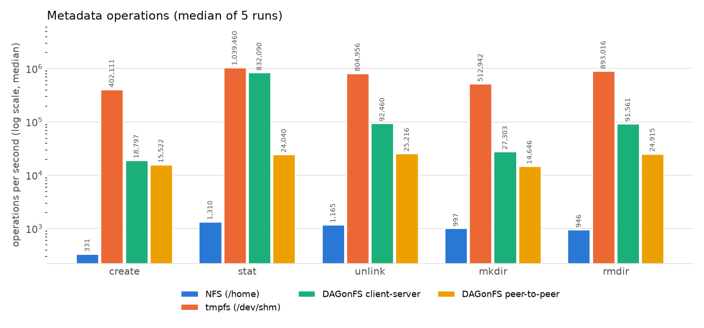
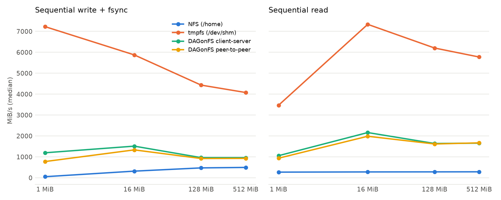

# Performance methodology and tuning

## 1. What DAGonFS optimizes

DAGonFS removes persistent-storage latency from the workflow scratch path and distributes payload blocks across MPI ranks. The expected gain is largest when a workflow repeatedly creates, reads, and writes temporary files whose working set fits in aggregate RAM. It is not a universal replacement for a durable parallel filesystem.

The observed time for an operation can be decomposed conceptually as

\[
T_{operation} = T_{FUSE} + T_{metadata} + T_{MPI} + T_{memory}.
\]

For small files, FUSE crossings and metadata management dominate. For large files, MPI communication and memory-copy costs dominate. This model is useful when interpreting measurements: a bandwidth result should include the file size, block size, rank count, host topology, and whether caches were warm.

## 2. Measured operation latency

Table 1 reports the mean latency per operation in a peer-to-peer volume, measured on two nodes with two ranks each, from rank 0's mount (see [TESTING.md](TESTING.md) §4.1).

**Table 1 — peer-to-peer latency per operation across two nodes.**

| Operation | Before D33 | Current |
| --- | --- | --- |
| `mkdir` / `rmdir` | 363 / 450 ms | 0.43 / 0.03 ms |
| create / `unlink` | 427 / 415 ms | 0.07 / 0.03 ms |
| write 4 KiB / read 4 KiB | 373 / 476 ms | 0.26 / 0.20 ms |

The earlier figures were dominated by the listener's blocking `MPI_Probe`. Under `MPI_THREAD_MULTIPLE` it held the MPI progress engine and delayed the front end's own messages. The listener now polls with `MPI_Iprobe` and an exponential back-off capped at 0.5 ms. An idle peer therefore costs a fraction of a core, and a request waits at most 0.5 ms before it is picked up. Namespace replays are asynchronous and do not add to the originator's latency. A write, however, waits for an acknowledgement from every rank.

## 3. Deployment guidance

- Use `Release` builds for measurement; debug logging and sanitizers materially alter timing.
- Select a rank count that matches available CPU and memory resources. Additional ranks may increase MPI coordination overhead for small files.
- Keep the workflow scratch set within aggregate RAM. Swapping reverses the intended performance advantage.
- Group very small temporary files when application semantics allow it; namespace operations have fixed FUSE and metadata overhead.
- Avoid treating `fsync` as durable persistence. Export results to a persistent filesystem before a job ends.

## 4. DAGonFS versus NFS as DAGonStar scratch space

This section compares DAGonFS with the file system that HPC workflows most often use for scratch data: the NFS-mounted home directory. Node-local `tmpfs` is included as an upper bound. It is the fastest possible scratch space, but it is private to one node and cannot be shared by the tasks of a multi-node workflow.

### 4.1 Testbed

| Item | Value |
| --- | --- |
| Compute node | gn05: 2 × Intel Xeon Gold 5420+ (56 cores), 755 GB RAM, Rocky Linux 8.10 (kernel 4.18) |
| NFS | `/home`, NFS 4.2 over TCP, `rsize = wsize = 1 MiB`, hard mount, served by a dedicated file server |
| tmpfs | `/dev/shm` on the compute node |
| DAGonFS | 4 ranks on the compute node (Open MPI 4.1.4, shared-memory transport), Release build, 128 KiB blocks |
| Workflow engine | DAGonStar (upstream `main`, November 2026), Python 3.11, local batch tasks |
| Slurm job | 19406, exclusive node, 15 November 2026 |

### 4.2 Method

`bench/run.py` measures each target in turn with the same two programs:

* `bench/fsbench.py` runs micro-benchmarks, five repetitions each, reported as the median:
  * creation, `stat` and removal of 2000 files, and creation and removal of 2000 directories;
  * write-then-read of 1000 files of 4 KiB;
  * sequential write (ending with `fsync`) and read of files of 1 to 512 MiB, in 1 MiB requests.

  Before each read, the file's pages are dropped from the client page cache (`posix_fadvise(POSIX_FADV_DONTNEED)`). An NFS read therefore crosses the network instead of being served by the page cache that the preceding write just filled.
* `bench/workflow.py` runs two **real DAGonStar workflows**, three times each. The workflow scratch directory (`scratch_dir_base`) is placed on the target. Every dependency is a `workflow://` reference, which DAGonStar stages by copying the producer's output into the consumer's directory.
  * **Large files:** a producer writes 8 files of 128 MiB. Eight parallel tasks each stage one file, copy it, and write a 256 MiB output. A reducer stages the eight outputs and concatenates them into 2 GiB. About 9 GiB are written to the file system, and as much is read back.
  * **Small files:** a producer writes 2000 files of 8 KiB. Eight parallel tasks each stage the whole directory and pack it into a tar archive. A reducer stages and concatenates the archives. The run performs about 18 000 file creations.

  The reducer's output size is checked after every run, so an incomplete or failed workflow cannot be reported as a fast one.

DAGonFS volumes are created and destroyed for each target through the Python volume API (`python/dagonfs`). The peer-to-peer volume is used through rank 0's mount point, so it pays for replicating every operation to three peers.

### 4.3 Micro-benchmarks






**Table 2 — micro-benchmarks, median of five runs, one node.**

| Metric | NFS | tmpfs | DAGonFS client-server | DAGonFS peer-to-peer | DAGonFS CS / NFS |
| --- | ---: | ---: | ---: | ---: | ---: |
| create (ops/s) | 331 | 402,111 | 18,797 | 15,522 | 57× |
| stat (ops/s) | 1,310 | 1,039,460 | 832,090 | 24,040 | 635× |
| unlink (ops/s) | 1,165 | 804,956 | 92,460 | 25,216 | 79× |
| mkdir (ops/s) | 997 | 512,942 | 27,303 | 14,646 | 27× |
| rmdir (ops/s) | 946 | 893,016 | 91,561 | 24,915 | 97× |
| 4 KiB files, write (files/s) | 194 | 187,894 | 4,562 | 4,393 | 24× |
| 4 KiB files, read (files/s) | 268 | 252,347 | 5,020 | 3,270 | 19× |
| 1 MiB write (MiB/s) | 53 | 7,227 | 1,197 | 777 | 23× |
| 1 MiB read (MiB/s) | 271 | 3,469 | 1,057 | 937 | 3.9× |
| 16 MiB write (MiB/s) | 318 | 5,877 | 1,514 | 1,335 | 4.8× |
| 16 MiB read (MiB/s) | 281 | 7,337 | 2,163 | 1,986 | 7.7× |
| 128 MiB write (MiB/s) | 474 | 4,432 | 965 | 922 | 2.0× |
| 128 MiB read (MiB/s) | 284 | 6,204 | 1,640 | 1,617 | 5.8× |
| 512 MiB write (MiB/s) | 496 | 4,077 | 963 | 928 | 1.9× |
| 512 MiB read (MiB/s) | 287 | 5,774 | 1,656 | 1,671 | 5.8× |

*Comments.*

* **Metadata.** NFS pays a network round trip to the server for every create, remove and attribute check, so it sustains only 330–1300 operations per second. DAGonFS answers these operations from the front end's memory and is faster by one to two orders of magnitude.
  * The client-server `stat` rate (832 000 ops/s) comes close to tmpfs because the kernel caches attributes for 1 s, so most `stat` calls never reach the file system.
  * Peer-to-peer volumes disable that cache (D38) and replicate every namespace change to the other peers. They are 1.2–3.7× slower than client-server volumes on creation and removal, but still 15–47× faster than NFS on every metadata operation.
* **Small files.** A 4 KiB file costs one round trip per `open`, `write`/`read` and `close` on NFS (about 5 ms per file). On DAGonFS it costs three FUSE crossings plus one point-to-point exchange with the storage ranks, about 0.2 ms.
* **Large files.** DAGonFS writes at 0.9–1.5 GiB/s and reads at 1.0–2.2 GiB/s, against 0.05–0.5 GiB/s for NFS. For large files, three costs keep it at about a quarter of tmpfs: every request crosses the FUSE boundary twice, the front end buffers the whole file, and the data are copied once more to distribute them over the ranks.
  * Write throughput levels off from 128 MiB, where buffer growth and distribution dominate.
  * The NFS write rate rises with file size because NFS writes back asynchronously until the final `fsync`. Its median read rate, about 280 MiB/s, reflects the server's response once the client cache has been dropped.

### 4.4 DAGonStar workflows


**Table 3 — DAGonStar workflow wall time, median of three runs (min–max), one node.**

| Workflow | NFS | tmpfs | DAGonFS client-server | DAGonFS peer-to-peer |
| --- | ---: | ---: | ---: | ---: |
| 8 × 128 MiB (≈ 9 GiB of I/O) | 59.7 s (56.0–64.0) | 14.3 s (14.1–14.4) | **25.1 s** (25.0–25.4) | 26.5 s (26.5–26.7) |
| 2000 × 8 KiB files, 8 tasks | 208.6 s (198.1–231.7) | 14.4 s (14.3–14.4) | **22.9 s** (22.5–23.4) | 23.5 s (23.3–24.1) |
| Speed-up over NFS, large / small | 1× / 1× | 4.2× / 14.5× | **2.4× / 9.1×** | 2.3× / 8.9× |

*Comments.*

* **DAGonFS made both workflows 2.4× and 9.1× faster than NFS.** The gain is larger for the small-file workflow because it is dominated by metadata operations, where NFS is weakest (§4.3). This is the typical profile of workflow scratch data: many intermediate files, created once, read once, and discarded.
* **DAGonStar's own overhead.** DAGonStar polls task state with fixed sleeps, so even a workflow that moves almost no data takes about 7 s (measured with 2 × 4 MiB files on tmpfs). Discounting that floor, DAGonFS spends about 18 s on the large workflow's I/O against 53 s for NFS. For the small-file workflow it spends about 16 s against about 200 s, roughly 13× less.
* **Variability.** NFS runs vary by up to 11% from the median, because the file server is shared with the rest of the cluster. DAGonFS and tmpfs runs stay within about 2%, because their performance depends only on the allocated node.
* **Peer-to-peer cost.** Replicating the namespace to three peers costs 3–6% of workflow time in peer-to-peer mode. In exchange, every node of a multi-node workflow sees the same tree.
* **Distance from tmpfs.** On one node, DAGonFS remains 1.6–1.8× slower than tmpfs. That is the price of a user-space file system whose data are distributed over the ranks of a job. Unlike tmpfs, DAGonFS presents one namespace to tasks running on different nodes, and its capacity is the memory of all ranks rather than of one node.

### 4.5 Threats to validity

* The NFS server is shared with other users, and its load during the job is unknown. The minimum–maximum ranges in Table 3 bound its effect on these runs.
* Dropping the client page cache makes NFS reads honest about the network but not about the server: data written moments earlier are likely still in the server's memory. The NFS read figures are therefore an upper bound for cold data.
* DAGonFS volumes ran with four ranks on one node, so the transfers use MPI's shared-memory transport. The cross-node latency of individual operations is reported in §2. A two-node repetition of the workflows did not complete (§4.6).
* DAGonFS is volatile and NFS is durable; the comparison concerns scratch data that a workflow discards when it ends.

### 4.6 Memory sizing, and the two-node attempt

The same benchmark was submitted on two nodes with two ranks each (Slurm job 19407), without `--exclusive` and without a memory request. On this cluster such a job receives the default of 1 GB per allocated CPU, so 2 GB per node. Slurm stopped it during the first large-file workflow ("oom_kill event"), and the client-server mount lost its connection to the killed rank. This is the expected outcome of under-sizing, not a DAGonFS defect. DAGonFS keeps all data in memory, and each rank must hold:

* its share of the stored data, about $\frac{1}{P}$ of everything written and not yet removed (≈ 9 GiB / 4 here, since the benchmark removes the scratch directory only after a run);
* on a front end, the whole content of every file that is open, up to 2 GiB for the reducer's output here;
* the MPI and FUSE buffers.

Request memory explicitly (`--mem` per node, or `--exclusive`) for at least the scratch working set divided by the number of nodes, plus the largest open files on the front-end node. The single-node run was exclusive and had the node's 755 GB.

## 5. Reproducing the measurements

```bash
cmake -S . -B build -DUSE_MPI=ON -DCMAKE_BUILD_TYPE=Release && cmake --build build -j
python3.11 -m venv venv && venv/bin/pip install matplotlib "git+https://github.com/DagOnStar/dagonstar.git"
sbatch -p <partition> -N 1 -n 4 --exclusive bench/slurm/bench.sbatch build venv/bin/python   # or --mem=<size>
venv/bin/python bench/plot.py --out figures bench/results/bench-<jobid>.json
```

`bench/run.py --targets nfs,tmpfs,dagonfs-cs,dagonfs-p2p` selects the targets, and `--nfs-dir` the NFS directory. `BENCH_ARGS` passes these options through the Slurm script. Every partition used must provide FUSE 3 (`fuse3-libs` and a set-uid `fusermount3`) on its nodes. The raw results of this section are kept in `bench/results/`. Report distributions rather than single timings, and state the durability difference whenever a volatile file system is compared with a durable one.

## 6. References

- libfuse project, *FUSE: Filesystem in Userspace*. The low-level API defines request/reply and cache semantics used by DAGonFS.
- MPI Forum, *MPI: A Message-Passing Interface Standard*. MPI point-to-point communication provides the distributed communication substrate.
- DAGonStar, https://github.com/DagOnStar/dagonstar: the workflow engine used in §4.
- De Vita et al., “An ad-hoc file system accelerated workflow application for accidental fire fast response,” WiDE ’24. The project README contains the full bibliographic record and DOI.
