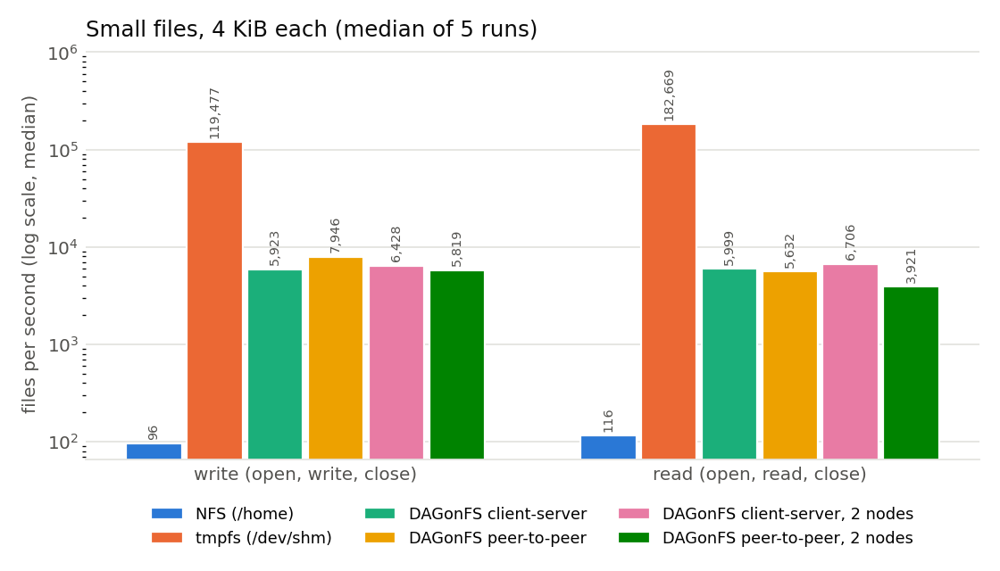
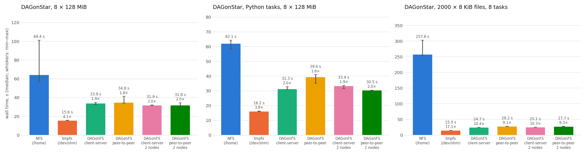

# Performance methodology and tuning

## 1. What DAGonFS optimizes

DAGonFS removes persistent-storage latency from the workflow scratch path and distributes payload blocks across MPI ranks. The expected gain is largest when a workflow repeatedly creates, reads, and writes temporary files whose working set fits in aggregate RAM. It is not a universal replacement for a durable parallel filesystem.

The observed time for an operation can be decomposed conceptually as

\[
T_{operation} = T_{FUSE} + T_{metadata} + T_{MPI} + T_{memory}.
\]

For small files, FUSE crossings and metadata management dominate. For large files, MPI communication and memory-copy costs dominate. This model is useful when interpreting measurements: a bandwidth result should include the file size, block size, rank count, host topology, and whether caches were warm.

## 2. Measured operation latency

Table 1 reports the mean latency per operation in a peer-to-peer volume, measured on two nodes with two ranks each, from rank 0's mount (see [TESTING.md](TESTING.md) §4.2).

**Table 1 — peer-to-peer latency per operation across two nodes.**

| Operation | Before D33 | Current |
| --- | --- | --- |
| `mkdir` / `rmdir` | 363 / 450 ms | 0.43 / 0.03 ms |
| create / `unlink` | 427 / 415 ms | 0.07 / 0.03 ms |
| write 4 KiB / read 4 KiB | 373 / 476 ms | 0.26 / 0.20 ms |

The earlier figures were dominated by the listener's blocking `MPI_Probe`. Under `MPI_THREAD_MULTIPLE` it held the MPI progress engine and delayed the front end's own messages. The listener now polls with `MPI_Iprobe` and an exponential back-off capped at 0.5 ms. An idle peer therefore costs a fraction of a core, and a request waits at most 0.5 ms before it is picked up. Namespace replays are asynchronous and do not add to the originator's latency. A write, however, waits for an acknowledgement from every rank.

## 3. Deployment guidance

- Use `Release` builds for measurement; debug logging and sanitizers materially alter timing.
- Select a rank count that matches available CPU and memory resources. Additional ranks may increase MPI coordination overhead for small files.
- Keep the workflow scratch set within aggregate RAM. Swapping reverses the intended performance advantage.
- Group very small temporary files when application semantics allow it; namespace operations have fixed FUSE and metadata overhead.
- Avoid treating `fsync` as durable persistence. Export results to a persistent filesystem before a job ends.

## 4. DAGonFS versus NFS as DAGonStar scratch space

This section compares DAGonFS with the file system that HPC workflows most often use for scratch data: the NFS-mounted home directory. Node-local `tmpfs` is included as an upper bound. It is the fastest possible scratch space, but it is private to one node and cannot be shared by the tasks of a multi-node workflow.

### 4.1 Testbed

| Item | Value |
| --- | --- |
| Compute nodes | Slurm partition `low-wn`: 2 × Intel Xeon Gold 5218 (32 cores), 187 GB RAM, InfiniBand (mlx5), Rocky Linux 8.10 (kernel 4.18.0-553) |
| FUSE | libfuse 3.3.0 with `fusermount3` 3.3.0 |
| NFS | `/home`, NFS 4.2 over TCP, `rsize = wsize = 1 MiB`, hard mount, served by a dedicated file server |
| tmpfs | `/dev/shm` on the compute node |
| DAGonFS | 4 ranks, Open MPI 4.1.4 (UCX 1.15, HCOLL disabled as of D47), Release build, 128 KiB blocks, `--map-by slot --bind-to none` |
| Workflow engine | DAGonStar 1.0.2, Python 3.11.13, local batch tasks |
| One node | Slurm job 19513 on wn01, 4 ranks, `--exclusive --mem=96G` |
| Two nodes | Slurm job 19514 on wn02–wn03, 2 ranks per node, `--exclusive --mem=96G` |

Both jobs ran at the same time on 15 November 2026, from 18:57, on separate nodes, and each measured every target. In the two-node job, NFS and tmpfs are still used from the first node, so only the DAGonFS rows of that job differ in kind: their blocks are spread over both nodes, and half of every transfer crosses InfiniBand.

The same benchmark had run four hours earlier on the same nodes (jobs 19453 and 19454, without `--exclusive`, before the D47 fix). §4.5 compares the two runs; their raw results are kept as well.

### 4.2 Method

`bench/run.py` measures each target in turn with the same two programs:

* `bench/fsbench.py` runs micro-benchmarks, five repetitions each, reported as the median:
  * creation, `stat` and removal of 2000 files, and creation and removal of 2000 directories;
  * write-then-read of 1000 files of 4 KiB;
  * sequential write (ending with `fsync`) and read of files of 1 to 512 MiB, in 1 MiB requests.

  Before each read, the file's pages are dropped from the client page cache (`posix_fadvise(POSIX_FADV_DONTNEED)`). An NFS read therefore crosses the network instead of being served by the page cache that the preceding write just filled.
* `bench/workflow.py` runs three **real DAGonStar workflows**, three times each. The workflow scratch directory (`scratch_dir_base`) is placed on the target. Every dependency is a `workflow://` reference, which DAGonStar stages by copying the producer's output into the consumer's directory.
  * **Large files:** a producer writes 8 files of 128 MiB with `dd`. Eight parallel tasks each stage one file, copy it, and write a 256 MiB output with `cat`. A reducer stages the eight outputs and concatenates them into 2 GiB. About 9 GiB are written to the file system, and as much is read back.
  * **Python tasks:** the same dataflow, but every task is a Python program (`bench/pytask.py`) that reads and writes its files with Python file objects in 1 MiB requests. The transforms write each chunk twice and `fsync` their output. The reducer recomputes the expected content of every chunk and compares it before concatenating, so the run fails if any task read, or DAGonStar staged, wrong data.
  * **Small files:** a producer writes 2000 files of 8 KiB. Eight parallel tasks each stage the whole directory and pack it into a tar archive. A reducer stages and concatenates the archives. The run performs about 18 000 file creations.

  The reducer's output size is checked after every run, so an incomplete or failed workflow cannot be reported as a fast one.

DAGonFS volumes are created and destroyed for each target through the Python volume API (`python/dagonfs`). The peer-to-peer volume is used through rank 0's mount point, so it pays for replicating every operation to three peers.

### 4.3 Micro-benchmarks





**Table 2 — micro-benchmarks, median of five runs (jobs 19513 and 19514).** "CS" is client-server, "P2P" peer-to-peer. NFS and tmpfs are reported from the one-node job.

| Metric | NFS | tmpfs | CS, 1 node | P2P, 1 node | CS, 2 nodes | P2P, 2 nodes |
| --- | ---: | ---: | ---: | ---: | ---: | ---: |
| create (ops/s) | 67 | 272,010 | 25,532 | 26,943 | 41,772 | 16,888 |
| stat (ops/s) | 151 | 690,129 | 592,191 | 42,318 | 682,304 | 23,529 |
| unlink (ops/s) | 181 | 680,908 | 84,573 | 40,073 | 157,751 | 23,725 |
| mkdir (ops/s) | 124 | 364,622 | 37,604 | 35,406 | 64,932 | 21,449 |
| rmdir (ops/s) | 153 | 656,468 | 86,994 | 40,655 | 164,601 | 23,686 |
| 4 KiB files, write (files/s) | 96 | 119,477 | 5,923 | 7,946 | 6,428 | 5,819 |
| 4 KiB files, read (files/s) | 116 | 182,669 | 5,999 | 5,632 | 6,706 | 3,921 |
| 1 MiB write (MiB/s) | 54 | 5,502 | 897 | 1,017 | 876 | 775 |
| 1 MiB read (MiB/s) | 79 | 2,783 | 884 | 1,296 | 1,215 | 833 |
| 16 MiB write (MiB/s) | 202 | 4,808 | 1,015 | 972 | 982 | 917 |
| 16 MiB read (MiB/s) | 115 | 5,262 | 1,298 | 1,282 | 1,653 | 1,300 |
| 128 MiB write (MiB/s) | 411 | 3,367 | 637 | 793 | 745 | 597 |
| 128 MiB read (MiB/s) | 165 | 5,195 | 1,121 | 1,355 | 1,364 | 1,175 |
| 512 MiB write (MiB/s) | 283 | 3,371 | 647 | 841 | 754 | 591 |
| 512 MiB read (MiB/s) | 117 | 5,521 | 1,186 | 1,387 | 1,392 | 1,188 |

*Comments.*

* **Metadata.** NFS pays a network round trip to the server for every create, remove and attribute check. In this run it sustained only 66–151 operations per second, three to four times fewer than four hours earlier (§4.5). DAGonFS answers these operations from the front end's memory, at 17 000–680 000 operations per second.
  * The client-server `stat` rate (590 000–680 000 ops/s) comes close to tmpfs because the kernel caches attributes for 1 s, so most `stat` calls never reach the file system.
  * Peer-to-peer volumes disable that cache (D38) and replicate every namespace change to the other peers. Their `stat` rate is therefore an order of magnitude lower, and their other metadata rates are 17 000–43 000 ops/s.
  * Repeated runs on the same node with the same binary gave client-server create rates of about 25 000 or about 41 000 ops/s (§4.5). The difference between the one-node and two-node client-server columns is of that kind, not an effect of spreading the volume.
* **Small files.** A 4 KiB file costs one round trip per `open`, `write`/`read` and `close` on NFS, about 10 ms per file in this run. On DAGonFS it costs three FUSE crossings plus one point-to-point exchange with the storage ranks, about 0.15 ms.
* **Large files.** DAGonFS writes at 0.6–1.0 GiB/s and reads at 0.8–1.6 GiB/s, against 0.05–0.4 GiB/s for NFS. For large files, three costs keep it at a fifth to a third of tmpfs: every request crosses the FUSE boundary twice, the front end buffers the whole file, and the data are copied once more to distribute them over the ranks.
  * The NFS write rate rises with file size because NFS writes back asynchronously until the final `fsync`. Its read rate, 79–165 MiB/s, reflects the server's response once the client cache has been dropped.

### 4.4 DAGonStar workflows



**Table 3 — DAGonStar workflow wall time, median of three runs (min–max), jobs 19513 and 19514.**

| Workflow | NFS | tmpfs | DAGonFS CS, 1 node | DAGonFS P2P, 1 node | DAGonFS CS, 2 nodes | DAGonFS P2P, 2 nodes |
| --- | ---: | ---: | ---: | ---: | ---: | ---: |
| 8 × 128 MiB, shell tasks (≈ 9 GiB of I/O) | 64.4 s (56.9–101.2) | 15.6 s (15.6–15.8) | **33.9 s** (32.2–34.9) | 34.8 s (34.0–41.3) | 31.9 s (31.4–32.2) | 31.8 s (31.3–34.4) |
| 8 × 128 MiB, Python tasks | 62.1 s (58.3–64.3) | 16.2 s (16.0–16.3) | **31.3 s** (30.8–32.8) | 39.4 s (35.1–41.0) | 33.4 s (31.4–33.7) | 30.5 s (30.1–30.5) |
| 2000 × 8 KiB files, 8 tasks | 257.6 s (253.8–302.8) | 15.0 s (14.9–15.1) | **24.7 s** (24.5–24.9) | 28.2 s (27.3–28.4) | 25.1 s (25.0–25.4) | 27.7 s (27.2–28.1) |
| Speed-up over NFS (shell / Python / small) | 1× | 4.1× / 3.8× / 17.1× | **1.9× / 2.0× / 10.4×** | 1.8× / 1.6× / 9.1× | 2.0× / 1.9× / 10.3× | 2.0× / 2.0× / 9.3× |

The two-node speed-ups are computed against the one-node NFS times. The two-node job measured NFS within 5% of them (61.4 s, 59.5 s and 259.4 s).

*Comments.*

* **DAGonFS made the workflows 1.6–2.0× faster than NFS on large files and 9.1–10.4× faster on small files.** Across the two runs of §4.5 the range is 1.6–2.1× and 8.9–11.8×. The gain is largest for the small-file workflow because it is dominated by metadata operations, where NFS is weakest (§4.3). This is the typical profile of workflow scratch data: many intermediate files, created once, read once, and discarded.
* **Python tasks.** Tasks that read and write through Python file objects see the same benefit as shell tools: 31.3 s on DAGonFS against 62.1 s on NFS. Every byte that the reducer read was checked against its expected content in every run, in both models and on both node counts.
* **DAGonStar's own overhead.** DAGonStar polls task state with fixed sleeps, so even a workflow that moves almost no data takes about 7 s. Discounting that floor, DAGonFS spends 24–27 s on the large workflows' I/O against 55–57 s for NFS, and about 18 s on the small-file workflow against about 250 s.
* **Two nodes.** Spreading the volume over two nodes did not make the workflows slower in this run: the two-node times lie within −23% to +7% of the one-node ones, a spread comparable to the differences between repeated runs (§4.5). In exchange, tasks on either node see the same tree, and the volume's capacity is the memory of both nodes.
* **Peer-to-peer cost.** Replicating the namespace to three peers cost 0–26% over client-server volumes on one node, and −9% to +10% on two nodes. It is most visible on the small-file workflow, which creates about 18 000 files.
* **Distance from tmpfs.** DAGonFS remains 1.6–2.4× slower than node-local tmpfs. That is the price of a user-space file system whose data are distributed over the ranks of a job. Unlike tmpfs, DAGonFS presents one namespace to tasks running on different nodes.

### 4.5 Repeatability and threats to validity

**Table 4 — workflow medians in the two runs of 15 November 2026** (jobs 19453/19454 at 14:56, without `--exclusive`; jobs 19513/19514 at 18:57, exclusive nodes, with the D47 fix).

| Workflow | NFS | DAGonFS CS, 1 node | DAGonFS P2P, 1 node | DAGonFS CS, 2 nodes | DAGonFS P2P, 2 nodes |
| --- | ---: | ---: | ---: | ---: | ---: |
| 8 × 128 MiB, shell tasks | 61.8 → 64.4 s | 28.8 → 33.9 s | 29.2 → 34.8 s | 31.5 → 31.9 s | 34.8 → 31.8 s |
| 8 × 128 MiB, Python tasks | 55.5 → 62.1 s | 28.2 → 31.3 s | 30.1 → 39.4 s | 29.8 → 33.4 s | 31.1 → 30.5 s |
| 2000 × 8 KiB files | 270.4 → 257.6 s | 22.9 → 24.7 s | 26.2 → 28.2 s | 24.1 → 25.1 s | 30.4 → 27.7 s |

* **DAGonFS run-to-run variation.** The DAGonFS medians changed by −9% to +31% between the two runs. The one-node volumes were slower in the second run, although they had wn01 to themselves. The only change to DAGonFS between the runs was the D47 fix, which disables an MPI collective library that DAGonFS never calls. A separate test on wn01 (job 19521) alternated two runs with that library disabled and two with it enabled. Within each mode, the client-server create rate was about 25 000 ops/s in one run and about 41 000 ops/s in the other, and the workflow times varied by up to 12%. The fix therefore has no measurable effect, and differences of this size between runs are not significant. Compare configurations within one run, and treat single-run differences under about 30% as noise.
* **NFS load.** The NFS server is shared with other users, and its load is unknown. Its metadata and small-file rates were three to four times lower in the second run, while its workflow times changed by −5% to +12%, and one large-workflow run took 101 s. The speed-ups over NFS therefore depend on the server's load. The minimum–maximum ranges in Table 3 show its effect within a run.
* **Cache effects.** Dropping the client page cache makes NFS reads honest about the network but not about the server: data written moments earlier are likely still in the server's memory. The NFS read figures are therefore an upper bound for cold data.
* **Durability.** DAGonFS is volatile and NFS is durable; the comparison concerns scratch data that a workflow discards when it ends.

### 4.6 Memory sizing

DAGonFS keeps all data in memory, and each rank must hold:

* its share of the stored data, about $\frac{1}{P}$ of everything written and not yet removed (≈ 9 GiB / 4 here, since the benchmark removes the scratch directory only after a run);
* on a front end, the whole content of every file that is open, up to 2 GiB for the reducer's output here;
* the MPI and FUSE buffers.

Request memory explicitly (`--mem` per node, or `--exclusive`) for at least the scratch working set divided by the number of nodes, plus the largest open files on the front-end node. The jobs of this section requested `--mem=96G` per node. A job that relies on a cluster's default per-CPU memory limit (1 GB per CPU on this cluster) is stopped by Slurm's out-of-memory killer during the first large workflow, and the client-server mount then loses its connection to the killed rank.

## 5. Reproducing the measurements

```bash
module load <MPI module>   # sbatch exports the submitting environment: mpirun must be on PATH
cmake -S . -B build -DUSE_MPI=ON -DCMAKE_BUILD_TYPE=Release && cmake --build build -j
python3.11 -m venv venv && venv/bin/pip install matplotlib dagonstar
sbatch -p <partition> -N 1 -n 4 --exclusive --mem=96G bench/slurm/bench.sbatch build venv/bin/python
sbatch -p <partition> -N 2 --ntasks-per-node=2 --exclusive --mem=96G bench/slurm/bench.sbatch build venv/bin/python
venv/bin/python bench/plot.py --out figures bench/results/bench-<one-node>.json \
    "bench/results/bench-<two-node>.json:2 nodes:dagonfs-cs,dagonfs-p2p"
```

`bench/run.py --targets nfs,tmpfs,dagonfs-cs,dagonfs-p2p` selects the targets, and `--nfs-dir` the NFS directory. `BENCH_ARGS` passes these options through the Slurm script. The script stops at once if `mpirun` is not on `PATH`. Every node used must provide `/dev/fuse`, the libfuse 3 runtime (`fuse3-libs`) and a set-uid FUSE helper: `fusermount3`, or the FUSE 2 `fusermount`, which the Slurm script links as `fusermount3` through `tests/slurm/fuse-env.sh`. The raw results of this section are kept in `bench/results/`: `bench-19513.json` and `bench-19514.json` (Tables 2–3), and `bench-19453.json` and `bench-19454.json` (the earlier run of Table 4). Report distributions rather than single timings, and state the durability difference whenever a volatile file system is compared with a durable one.

## 6. References

- libfuse project, *FUSE: Filesystem in Userspace*. The low-level API defines request/reply and cache semantics used by DAGonFS.
- MPI Forum, *MPI: A Message-Passing Interface Standard*. MPI point-to-point communication provides the distributed communication substrate.
- DAGonStar, https://github.com/DagOnStar/dagonstar: the workflow engine used in §4.
- De Vita et al., “An ad-hoc file system accelerated workflow application for accidental fire fast response,” WiDE ’24. The project README contains the full bibliographic record and DOI.
