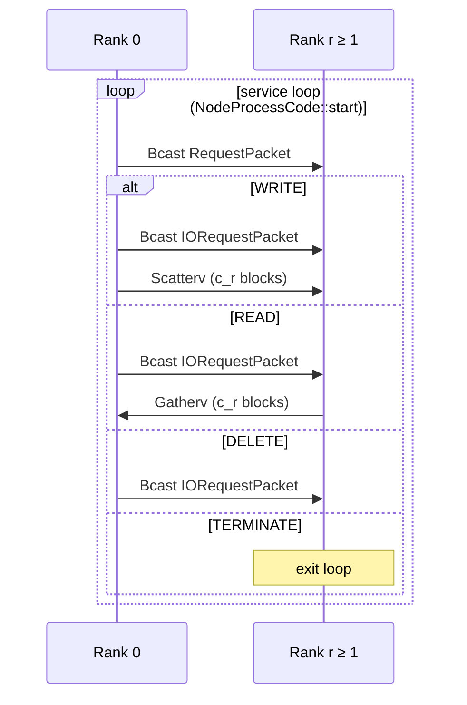

# Control-plane protocol

All messages use `MPI_COMM_WORLD`. Packets are plain C structures transmitted as `MPI_BYTE`; every rank runs the same binary, so the layout is identical on all ranks (homogeneous clusters are assumed). Packets contain only value types and length-bounded byte strings: process-local addresses are never transmitted.

## 1. Client-server model

Rank 0 is the only originator. Every request is a broadcast `RequestPacket`, followed for data-plane operations by a broadcast `IORequestPacket`, followed by the collective of the operation.

```c
typedef enum { WRITE, READ, CHANGE_DIR, REDUCE_BLOCKS, TERMINATE, DELETE } RequestType;

typedef struct { RequestType type; } RequestPacket;          /* MPI_Bcast, root 0 */

typedef struct {                                               /* MPI_Bcast, root 0 */
    fuse_ino_t inode;     /* file identifier (local inode number of rank 0) */
    size_t     fileSize;  /* bytes to store, or stored bytes to load        */
    size_t     reqSize;   /* reserved (== fileSize)                         */
    off_t      offset;    /* reserved (0)                                   */
} IORequestPacket;
```

| Request | Payload | Collective that follows | Effect on storage ranks |
| --- | --- | --- | --- |
| `WRITE` | `IORequestPacket` | `MPI_Scatterv` rooted at 0 | Replace the local slice of `inode` |
| `READ` | `IORequestPacket` | `MPI_Gatherv` rooted at 0 | Send the local slice of `inode` |
| `DELETE` | `IORequestPacket` (`fileSize` = 0) | none | Release the local slice of `inode` |
| `TERMINATE` | none | none | Leave the service loop, `MPI_Finalize` |

`CHANGE_DIR` and `REDUCE_BLOCKS` are reserved values ignored by storage ranks. `TERMINATE` is sent unconditionally when the front end leaves `FileSystem::start`, including when mounting failed, so storage ranks can never be left blocked in `MPI_Bcast`.



## 2. Peer-to-peer model

Any peer may originate an operation. The originator sends **one self-describing message** with tag 0 to every *other* peer: a fixed `PeerRequest` header immediately followed by the bytes of at most two paths. The listener thread of the receiver matches the message with `MPI_Probe(MPI_ANY_SOURCE, 0)`, sizes its buffer with `MPI_Get_count`, and receives it **from the probed source**. Because a request is a single message, the payloads of concurrent originators can never be interleaved, and each replicated operation costs exactly one point-to-point message per peer.

```c
typedef enum { WRITE, READ, CREATE_FILE, DELETE_FILE, CREATE_DIR,
               DELETE_DIR, RENAME, TERMINATE, LINK } RequestType;

constexpr size_t DAGONFS_MAX_REQUEST_PATH = 4096;   /* incl. the NUL of the C string */

typedef struct { fuse_ino_t inode; size_t fileSize; size_t reqSize; off_t offset; } IORequestPacket;

typedef struct {
    RequestType     type;
    uint32_t        firstPathLength;   /* target / new object, < DAGONFS_MAX_REQUEST_PATH */
    uint32_t        secondPathLength;  /* RENAME / LINK destination, otherwise 0          */
    uint64_t        globalId;          /* CREATE_FILE only                                 */
    IORequestPacket io;                /* WRITE / READ only                                */
} PeerRequest;
/* wire image: PeerRequest | first path bytes | second path bytes (no terminators) */
```

Paths are relative to the peer's mount point and always start with `/`. Operations whose path would not fit fail locally with `ENAMETOOLONG` before anything is sent. The receiver rejects any message whose declared lengths exceed the bound or do not add up exactly to the received byte count, so a malformed message can never cause an out-of-bounds read.

| Request | Message contents | Receiver action (listener thread) |
| --- | --- | --- |
| `CREATE_FILE` | `globalId`, path | Publish `globalId`, set the replay flag, `open(O_CREAT\|O_EXCL)` on the local mount |
| `DELETE_FILE` | path | Set the replay flag, `unlink` |
| `CREATE_DIR` | path | Set the replay flag, `mkdir` |
| `DELETE_DIR` | path | Set the replay flag, `rmdir` |
| `RENAME` | old path, new path | Set the replay flag, `rename` |
| `LINK` | existing path, new path | Set the replay flag, `link` |
| `WRITE` | `io` (`inode` = global id) | Take part in `MPI_Scatterv` rooted at the source, update the replica's size, invalidate the kernel cache |
| `READ` | `io` (`inode` = global id) | Take part in `MPI_Gatherv` rooted at the source |
| `TERMINATE` | — | Unmount the local mount point with `fusermount3 -u` (`umount` on macOS) and leave the loop |

### 2.0 Why one message per request

An earlier revision sent a header and a fixed-size payload (two 4 KiB path arrays for `RENAME`) as two blocking sends per peer. Across nodes over a TCP transport the second, larger send crossed the eager/rendezvous threshold and each replicated metadata operation took about 200 ms, so the fifteen-scenario suite needed almost four minutes on two nodes. Sending only the bytes actually used, in a single eager message, removes the rendezvous handshake from the critical path (see [TESTING.md](TESTING.md) §4.1 for the measurements).

### 2.1 Replay flags

A replayed system call re-enters the peer's own FUSE thread through the kernel. The listener sets an `std::atomic<bool>` flag (`createFileFromThread`, `deleteFileFromThread`, …) immediately before the call; the FUSE handler consumes it with `exchange(false)` as its **first** statement, so an early error (for example `EEXIST`) cannot leave the flag set and cause the next locally originated operation to be silently withheld from the other peers. If the system call fails before reaching FUSE, the listener clears the flag itself.

### 2.2 Cluster-wide file identity

The data plane addresses a file by `globalId = ((creator rank + 1) << 48) | creator inode`, assigned once by the creating peer and adopted by replaying peers from the `CREATE_FILE` message. Each peer keeps a mutex-protected index from global id to local inode; the index is consulted by the listener to mirror the size of remotely written files. This removes any dependence on peers allocating local inode numbers in the same order.

### 2.3 Termination

When a peer's FUSE loop ends (the mount point was unmounted, or mounting failed), the peer sends `TERMINATE` to every peer including itself; its own listener then leaves its loop. Every other listener unmounts its local mount point, which ends that peer's FUSE loop, and marks the shutdown as externally initiated so that it does not broadcast `TERMINATE` again.

## 3. Ordering guarantees

MPI guarantees that messages between a pair of processes on the same communicator and tag are not overtaken. Hence all operations originated by one peer are replayed by every other peer in origination order, and a `WRITE` always follows the `CREATE_FILE` of the same file. No ordering is defined between operations originated by different peers.
